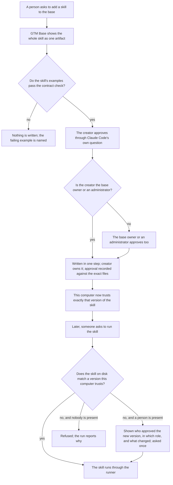

# Company skills: who owns them, who may change them, and what a seat will run

## Problem Frame

A company skill is a set of written steps for a recurring job, kept in a company's base so that everyone who joins the base can use it. The first one will be the Meta ads creative-testing skill, which Brandon already runs every night for the Gridwise driver app. Today a base refuses every file in its `skills/` folder, because nobody had settled who may approve a change to a skill (Brandon's call 13 of 2026-09-25). This document settles it, so the folder can open for approved skills and nothing else.

The hard part is not the folder. A skill is instructions that an assistant follows on every computer that runs it, so the real questions are who may write those instructions, how anyone can tell that the version about to run is one somebody allowed, and what happens when nobody is at the keyboard. Brandon answered the first question on 2026-10-10 (decision D5): whoever creates a skill or a document owns it, a change may be made and approved only by its owner, the base's owner or an administrator, and ownership has to be provable rather than claimed.

What can honestly be proven on one computer, with no signing of any kind, is narrower than "this particular person approved this". This document says exactly how much narrower, so nobody reads more into the guarantee than it gives.

Everything here applies to the whole base, not only to skills. A context document, a standard and the source map follow the same ownership rule. Skills get extra rules because they are instructions.

## User Flows

A change to an existing skill follows the same path from B, with a prepared change in place of the whole skill, and only the skill's owner, the base owner or an administrator may approve it. Passing a document to a new owner, and passing the base owner role itself, are their own small operations, described below.

## Requirements

**Who owns what, and who may change it**

- CS1. Whoever creates a document or a skill owns it. Their address is written on its `owner:` line when it is created, exactly as every document's owner is written today.
- CS2. The base owner is the single address on the map's `owner:` line. The administrators are the addresses on a new `administrators:` line in the map's settings, which may be empty.
- CS3. A change to a document or a skill may be made and approved only by an address in its authority set: its owners, the base owner, and the administrators. The same set decides whose confirmation counts when a document is said to be still right.
- CS4. Authority is judged as it stood when the approval or confirmation happened, read from the saved versions of the document and the map at that moment. A confirmation made before a document changed hands still counts; one the old owner makes afterwards does not. An approval an administrator made while they held the role stays valid after the role is removed.
- CS5. Any person who has joined the base may create a context document or a lesson, and owns it.
- CS6. Creating a skill needs two yeses: the creator's, and the base owner's or an administrator's, because a skill is instructions every computer on the base may run. When the creator is the base owner or an administrator, their one yes counts as both. The creator still owns the skill.
- CS7. A skill's references and examples belong to the skill and its owner. They are never owned separately.

**How an approval is proven, and what the proof covers**

- CS8. Every approval passes two checks. The address this computer is set up under must be in the authority set (CS3), and the approval must come through Claude Code's own permission question, which a person answers and the assistant cannot (Unit 1.7e, Brandon's call 57).
- CS9. Every approval is recorded in the base's record of corrections with the approver's address, the role that allowed it, the date, and a hash of the exact bytes approved. When something is created, the creator and the approver are recorded separately, even when they are the same person.
- CS10. For a skill, what is approved is one manifest: the base, the skill's name, the complete list of its files, and each file's hash. A computer runs a skill only when the skill on disk matches, file for file and byte for byte, a manifest that computer trusts. An extra file, a missing file, an edited file, an edit not yet saved, or files from two approved versions put together each match nothing.
- CS11. A computer trusts a manifest in exactly two ways: it was approved on that computer, or it was accepted once on that computer by a person who was shown who approved it, in which role, on what date, and what changed since the version that computer last trusted. The list of trusted manifests is kept in the plugin's own records folder on that computer, never in the base.
- CS12. The runner reads each file of a skill once, hashes what it read, and hands back exactly those bytes, so nothing can change between the check and the use.

**The guarantee, stated exactly (accepted by Brandon as call 6 of Plan 1)**

- CS13. On one trusted computer, with Claude Code set to ask before it runs commands and nothing set up to answer its questions automatically, a change is approved only by an address in the document's authority set, through Claude Code's own question; each approval is recorded with its approver, role and exact bytes; and a skill runs only as a whole version that computer approved or accepted.
- CS14. It does not prove which human answered the question, because the address a computer is set up under is a setting on that computer. It gives no protection against someone who controls the computer, or against an assistant with open command access that sets out to work around the check. In a mode where Claude Code asks nobody, approvals are refused. A setting or another plugin that answers Claude Code's questions on the person's behalf would answer this one too, so no such responder may cover GTM Base's approvals; this is checked on Brandon's own setup in the first live session. It does nothing for a second computer until that computer accepts the skill itself.

**When ownership changes hands**

- CS15. A document's owner line changes only through its own operation, approved by that document's authority set, previewed whole, bound to what was shown, and recorded with the reason.
- CS16. The base owner role passes only through its own operation on the map's `owner:` line, approved by the current base owner and nobody else.
- CS17. The administrators line changes only through its own operation, approved by the base owner. The list of businesses the base covers (the map's `businesses:` line) changes only through its own operation, approved by the base owner or an administrator.
- CS18. If the base owner is gone and cannot approve, GTM Base offers no way around it. Recovery is a matter for whoever controls the shared copy or the computer, and the join guide says so in plain words rather than hiding a back door in the product.

**What the skills folder may hold**

- CS19. A base admits exactly three shapes under `skills/`: `skills/<job>/SKILL.md`, `skills/<job>/references/<name>.md`, and files under `skills/<job>/examples/<example>/`. The job name and every file and folder name are lowercase letters, digits and hyphens, plus the file's extension.
- CS20. Only markdown (`.md`) and plain text (`.txt`) are admitted. A link, an executable file, a hidden file, any other extension, a folder deeper than these shapes, a file larger than 64 KB, and a skill with more than 50 files are each refused. The size limit is about three times the largest file the Meta skill has today (18.6 KB) and the file limit leaves room for examples; both are Brandon's to change by signing a different number here.
- CS21. A `SKILL.md` settings block may hold only these keys: `name`, `description`, `owner`, `reads` (each document the skill reads, marked required or optional), `standard` (always required), and `status`. Any other key is refused, which keeps out keys that would grant a skill power in Claude Code, such as allowed tools or hooks.
- CS22. A skill is written only through GTM Base's own create and change operations. A file tool writing into `skills/` directly is refused, as it is today. Admitting a file (may it exist here) and writing a file (who may put it here) are separate rules, tested separately.
- CS23. `CLAUDE.md`, `AGENTS.md`, `plugins/`, `.claude/`, and every script file stay refused everywhere in a base, exactly as today.

**Script files**

- CS24. Script files may not live in a base, in Plan 1 or after it, until three things exist: code pinned or signed so a computer runs only a version somebody approved, each computer's own consent to each version, and a settled answer to where such code runs. A script in a shared base runs on every teammate's computer with that person's permissions, and nothing in GTM Base can review what it does while it runs. A skill that needs code, such as the Meta skill's engine, keeps that code as a tool installed on each computer, and the base's source map lists it as a tool the job needs.

**How skills reach Claude**

- CS25. A base skill is delivered by the core plugin. At the start of a session, the base's injected context gains one line per skill this computer trusts: its name and its one-sentence description, presented as data. A plugin skill runs any base skill through the runner. A base skill is never copied into a person's own skills folder, because that would write outside the base.

**Examples, updates, staleness, audits**

- CS26. A skill carries at least one example, each with an input, the documents it ran against, an output the owner approved, an expectations file, and at least one deliberately wrong output. The runner's contract check runs them before any new skill or any change to a skill is shown for approval: the approved output must meet its expectations and every wrong output must fail. No model is called. Because examples are fixed text, a change in how a skill behaves is judged by the owner reading a real replay, which is required before a changed skill is approved.
- CS27. A change to a skill or a standard is prepared on request and approved by its authority set. The assistant proposing edits to a skill on its own after each run is not part of this; it waits until real use shows which edits are worth proposing.
- CS28. A skill goes stale the way any document does: when its confirmation is older than the base's threshold, or when a recorded context change names it. The review lists it. A check for duplicate or overlapping skills waits for a second company skill, because with one there is nothing to compare.

**Runs with nobody present**

- CS29. GTM Base builds no scheduler. Scheduled runs belong to the client's own scheduler, such as Claude Code's scheduled tasks.
- CS30. A run is unattended only when whoever starts it says so. In a conversation started as unattended, GTM Base refuses every approval, confirmation, creation, settings change and acceptance at once, without asking, so nothing is written and nothing waits on a question. A run of a skill whose version this computer does not trust is refused when unattended. A second refusal in the scheduler's own settings is added only where the scheduler has settings of its own, and is then tested on its own.

## Success Criteria

- The builder of Units 4.2a and 4.2b can build from this document without a second round of questions.
- In the first live session, Brandon approves a change to a document he owns, sees a change by another address refused in a sentence he understands, and can say in one sentence who may change his skill and what happens if someone else does.
- The Meta skill is installed into the Gridwise base under these rules, and a version that was not approved does not run.

## Scope Boundaries

- No second computer, no shared copy, no backup. The proof is built for one computer, which is every base that exists today.
- No signed changes. They become worth building with backup, because only then is there a second computer to verify against.
- No scripts in a base (CS24).
- No duplicate-skill audit (CS28).
- No assistant-initiated skill edits (CS27).
- No change to what may leave the computer.

## Key Decisions

| Decision | Why | Not chosen |
|---|---|---|
| Ownership is proven by approvals bound to exact bytes, and a computer runs only versions it trusts | Matching the owner line, the computer's address and the saved history proves only that three claims agree; anyone with the computer can write all three, and an owner-line check misses an edit to a skill's body | Reading a chain of owners from the saved history; signed changes before a shared copy exists |
| A skill is approved and trusted as one manifest, never file by file | File-by-file approval lets two approved versions be mixed into one nobody approved, or a reference be deleted unnoticed | Trusting each file against any approval |
| The base owner and administrators live in the map | The map is the one document the whole team shares and the base owner already owns, and it is never asked about | `CODEOWNERS`, which names GitHub handles rather than the addresses everything else uses; a new roles file |
| Creating a skill needs the base owner's or an administrator's yes as well | A skill is instructions every computer may run, which a context document is not | One yes from the creator alone |
| Unattended runs refuse approvals in the plugin, not through a list of allowed tools | Scheduled tasks inherit a person's allow rules and can wait on a question, so a list of allowed tools proves nothing | Relying on the scheduled task's tool list |
| Skills are delivered by the core plugin | Claude Code finds skills in a person's folder, a project's folder or a plugin, and a base folder is none of these | The base as its own plugin marketplace; copying skills into a person's folder |

## Dependencies / Assumptions

- Unit 1.7e as rebuilt by call 57 (option D) ships with Release B (0.4.0) or as 0.4.1 under call 58. Nothing in this document approves anything before it ships.
- Release B's layout (`skills/`, `standards/`, `access/`) is in place, and the Gridwise base has been moved to it through Release B's offered move.

## Outstanding Questions

### Resolve Before Planning

Brandon's signature decides these three, together with everything above:

1. Script files stay out of a base until the three conditions in CS24 exist.
2. Creating a skill needs the base owner's or an administrator's yes as well as the creator's (CS6).
3. The guarantee in CS13 and CS14 is accepted as the meaning of "provable" for now.

### Deferred to Planning

- The exact syntax of the map's `administrators:` and `businesses:` lines, within the map's existing settings grammar.
- What an unattended run should do with a skill changed by another computer, once a second computer exists: refuse it, or run the last version this computer trusted. With one computer, every change is that computer's own, so the question cannot arise yet.
- How acceptance is proven on a shared copy. To verify when backup is planned: whether GitHub's own signed records of a merge identify the person who accepted it (inferred, not checked), noting that a squash merge records the author rather than the person who accepted it.
- How many examples a skill needs before its set means something, decided when the first set exists.

## Next Steps

Brandon signs below. Then Unit 4.2a is briefed from Requirements CS1 to CS18 and CS30, and Unit 4.2b from CS10 to CS12, CS19 to CS26 and CS30.

**Signature**

Signed by Brandon Sellers on ______________, covering everything above, including the three items under "Resolve Before Planning".

## Revision Log

- 2026-10-10 r1: written from decision D5, Plan 1's Unit 4.1 table (revision 2.4, with calls 1 to 7 decided), the roadmap's eight questions, and the Meta skill's real files. Awaiting Astra's review and Brandon's signature.
