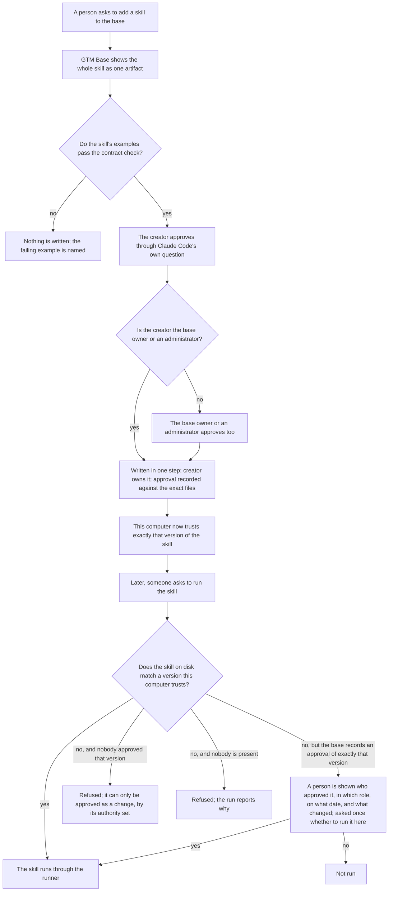

# Company skills: who owns them, who may change them, and what a computer will run

## Problem Frame

A company skill is a set of written steps for a recurring job, kept in a company's base so that everyone who joins the base can use it. The first one will be the Meta ads creative-testing skill, which Brandon already runs every night for the Gridwise driver app. Today a base refuses every file in its `skills/` folder, because nobody had settled who may approve a change to a skill (Brandon's call 13 of 2026-09-25). This document settles it, so the folder can open for approved skills and nothing else.

The hard part is not the folder. A skill is instructions that an assistant follows on every computer that runs it, so the real questions are who may write those instructions, how anyone can tell that the version about to run is one somebody allowed, and what happens when nobody is at the keyboard. Brandon answered the first question on 2026-10-10 (decision D5): whoever creates a skill or a document owns it, a change may be made and approved only by its owner, the base's owner or an administrator, and ownership has to be provable rather than claimed.

What can honestly be proven on one computer, with no signing of any kind, is narrower than "this particular person approved this". This document says exactly how much narrower, so nobody reads more into the guarantee than it gives.

A few words used throughout. The **map** is `context/map.md`, the base's settings file, and the **source map** is `access/stack.md`, the list of where data lives. A **hash** is a fingerprint of a file's exact contents: change one character and the fingerprint changes. **This computer** means the copy of the base on the computer in front of the person, together with the GTM Base records kept on that computer. The **runner** is the part of GTM Base every skill goes through: it checks the skill, reads the documents the skill needs, and hands them over. The **contract check** is an automatic check of a skill's example outputs against what each example says it must contain, with no AI involved.

Everything here applies to the whole base, not only to skills. A context document, a standard and the source map follow the same ownership rule. Skills get extra rules because they are instructions.

## User Flows

A change to an existing skill follows the same path from B, with a prepared change in place of the whole skill, and only the skill's owner, the base owner or an administrator may approve it. Passing a document to a new owner, and passing the base owner role itself, are their own small operations, described below.

## Requirements

**Who owns what, and who may change it**

- CS1. Whoever creates a document or a skill owns it. Their address is written on its `owner:` line when it is created, exactly as every document's owner is written today.
- CS2. The base owner is the address on the map's `owner:` line; a map whose owner line holds more than one address is refused by the authority rule until it holds one. The administrators are the addresses on a new `administrators:` line beside `owner:` in the settings block at the top of the map, which may be empty. The list of businesses (CS17) is a `businesses:` line in the same block.
- CS3. A change to a document or a skill may be made and approved only by an address in its authority set: its owners, the base owner, and the administrators. The same set decides whose confirmation counts when a document is said to be still right. A change becomes part of the base only when it is saved, and every way GTM Base saves a change (a prepared change, a kept hand edit, creation, the settings operations) checks the authority set first. A file tool may still edit a context document on disk, as it can today, but that unsaved edit is not part of the base: a skill reads each document as last saved, the check for whether a document has been overtaken by a context change is made against that same saved version, and the run says when unsaved edits were left out.
- CS4. Authority is judged as it stood when the approval or confirmation happened, read from the saved versions of the document and the map at that moment. A confirmation made before a document changed hands still counts; one the old owner makes afterwards does not. An approval an administrator made while they held the role stays valid after the role is removed.
- CS5. Any person who has joined the base may create a context document, a standard or a lesson, and owns it.
- CS6. Creating a skill needs two yeses: the creator's, and the base owner's or an administrator's, because a skill is instructions every computer on the base may run. When the creator is the base owner or an administrator, their one yes counts as both. The two yeses are two approvals of the same manifest, each passing CS8 under its own address, in either order. Until the second arrives, the skill waits as a prepared creation outside `skills/`, and either yes alone writes nothing. The creator still owns the skill.
- CS7. A skill's references and examples belong to the skill and its owner. They are never owned separately. A skill's owner is the `owner:` line of its `SKILL.md`, stamped before the skill is shown, so the bytes approved already carry it.

**How an approval is proven, and what the proof covers**

- CS8. Every approval passes two checks. The address this computer is set up under must be in the authority set (CS3), and the approval must come through Claude Code's own permission question, which a person answers and the assistant cannot (Unit 1.7e, Brandon's call 57).
- CS9. Every approval is recorded in the base's record of corrections with the approver's address, the role that allowed it, the date, and a hash of the exact bytes approved. When something is created, the creator and the approver are recorded separately, even when they are the same person. A confirmation that a document is still right is recorded the same way, with the address and the role, in its confirmation line; confirmation lines written before this change carry no role and are judged by the owner line, as today.
- CS10. For a skill, what is approved is one manifest: the base, the skill's name, the complete list of its files, and each file's hash. A computer runs a skill only when the skill on disk matches, file for file and byte for byte, a manifest that computer trusts. An extra file, a missing file, an edited file, an edit not yet saved, or files from two approved versions put together each match nothing.
- CS11. A computer trusts a manifest in exactly two ways. Either it was approved on that computer, under CS3 and CS8. Or the base's record of corrections already holds an approval of exactly that manifest by an address that was in its authority set at the time, and a person on that computer accepted it once, after being shown who approved it, in which role, on what date, and what changed since the version that computer last trusted. Accepting is consent to run a version somebody with authority already approved; it never approves anything. It goes through Claude Code's own question (CS8's second check), and it does not repeat the authority check, because the approval it points at already passed it. A version whose files do not match the recorded hashes is treated as having no approval. A version the base holds no such approval for cannot be accepted at all: it can only be approved as a change by its authority set, which records a new approval of the whole manifest. The list of trusted manifests is kept in the plugin's own records on that computer, never in the base.
- CS12. The runner reads each file of a skill once, hashes what it read, and hands back exactly those bytes, so nothing can change between the check and the use.

**The guarantee, stated exactly (accepted by Brandon as call 6 of Plan 1)**

- CS13. On one trusted computer, with Claude Code set to ask before it runs commands and nothing set up to answer its questions automatically, a change is approved only by an address in the document's authority set, through Claude Code's own question; each approval is recorded with its approver, role and exact bytes; and a skill runs only as a whole version that computer approved or accepted.
- CS14. It does not prove which human answered the question, because the address a computer is set up under is a setting on that computer. It gives no protection against someone who controls the computer, or against an assistant with open command access that sets out to work around the check. In Claude Code's modes that ask nobody (bypassPermissions and dontAsk), approvals are not refused: by Brandon's call 60 of Release B (2026-10-10) they go through with nobody asked, so in those modes nothing proves a person said yes. That is an accepted limit, which is why CS13 holds only with Claude Code set to ask before it runs commands. A setting or another plugin that answers Claude Code's questions on the person's behalf would answer this one too, so no such responder may cover GTM Base's approvals; this is checked on Brandon's own setup in the first live session. It does nothing for a second computer until that computer accepts the skill itself. For a document, as opposed to a skill, the rule governs what GTM Base saves, approves and records: someone with the files can still save a change to a document outside GTM Base, and a skill would then read it, whereas a skill itself runs only as approved bytes (CS10). Binding documents the same way waits for the shared-copy plan.

**When ownership changes hands**

- CS15. A document's owner line changes only through its own operation, approved by that document's authority set, previewed whole, bound to what was shown, and recorded with the reason.
- CS16. The base owner role passes only through its own operation on the map's `owner:` line, approved by the current base owner and nobody else.
- CS17. The administrators line changes only through its own operation, approved by the base owner. The list of businesses the base covers (the map's `businesses:` line) changes only through its own operation, approved by the base owner or an administrator. Which business a document or a skill belongs to (its `business:` line) changes only through its own operation, approved by that document's authority set, and its value must be a business the map lists. All five of these operations show the whole change first, are bound to what was shown, and are recorded with the reason.
- CS18. If the base owner is gone and cannot approve, GTM Base offers no way around it. Recovery is a matter for whoever controls the shared copy or the computer, and the join guide says so in plain words rather than hiding a back door in the product.

**What the skills folder may hold**

- CS19. This reopens the refusal on the skills folder narrowly, for the paths below and nothing else. A base admits exactly these paths under `skills/`: the empty placeholder file `skills/.gitkeep` that every base already has, which belongs to no skill; `skills/<job>/SKILL.md`; `skills/<job>/references/<name>.md`; and `skills/<job>/examples/<example>/<name>.md` or `.txt`, one folder per example and no deeper (narrower than Plan 1's `examples/**`, so an example is always one flat folder the contract check can list). The same paths are admitted on every path that refuses today: an update from a shared copy, the check when a base is opened, the file-writing check, and the check before a send; everything else under `skills/` stays refused on all four. Apart from the fixed name `SKILL.md`, the job name, the example name and every file name are lowercase letters, digits and hyphens, plus the file's extension.
- CS20. Only markdown (`.md`) and plain text (`.txt`) are admitted. A link, an executable file, a hidden file other than the placeholder, any other extension, a folder deeper than these shapes, a file larger than 64,000 bytes, and a skill with more than 50 files are each refused. The size limit is about three times the largest file the Meta skill has today (18,646 bytes) and the file limit leaves room for examples; both are Brandon's to change by signing a different number here.
- CS21. A `SKILL.md` settings block may hold only these keys: `name`, `description`, `owner`, `kind`, `business` (optional; a business the map lists), `sources`, `status`, `last_confirmed`, `reads_required` and `reads_optional` (each a list of the documents the skill reads), and `standard` (always required). These are the fields every base document already carries, plus the skill's own declarations. Any other key is refused, which keeps out keys that would grant a skill power in Claude Code, such as allowed tools or hooks.
- CS22. A skill is written only through GTM Base's own create and change operations. A file tool writing into `skills/` directly is refused, as it is today. Admitting a file (may it exist here) and writing a file (who may put it here) are separate rules, tested separately. A skill's files pass the same screens for contact details and keys as any prepared change before they are shown, with the owner's own address exempt as it is today.
- CS23. `CLAUDE.md`, `AGENTS.md`, `plugins/`, and every script file stay refused everywhere in a base, exactly as today. Under `.claude/`, the one file a base needs, `.claude/settings.json` at the top of the base, stays allowed and checked exactly as today, and everything else stays refused.

**Script files**

- CS24. Script files may not live in a base, in Plan 1 or after it, until three things exist: code pinned or signed so a computer runs only a version somebody approved, each computer's own consent to each version, and a settled answer to where such code runs. A script in a shared base runs on every teammate's computer with that person's permissions, and nothing in GTM Base can review what it does while it runs. A skill that needs code, such as the Meta skill's engine, keeps that code as a tool installed on each computer, and the base's source map lists it as a tool the job needs.

**How skills reach Claude**

- CS25. A base skill is delivered by the core plugin. At the start of a session, the base's injected context gains one line per skill this computer trusts: its name and its description, presented as data. A plugin skill runs any base skill through the runner. A base skill is never copied into a person's own skills folder, because that would write outside the base.

**Examples, updates, staleness, audits**

- CS26. A skill carries at least one example, each with an input, the documents it ran against, an output the owner approved, an expectations file, and at least one deliberately wrong output. The runner's contract check (an automatic check of those written outputs against the expectations, with no AI involved) runs them before any new skill or any change to a skill is shown for approval: the approved output must meet its expectations and every wrong output must fail. No model is called. Because examples are fixed text, a change in how a skill behaves is judged by the owner reading a real replay, which is required before a changed skill is approved. That reading is the duty of whoever approves, owner or not, and the plugin cannot check that it happened.
- CS27. A change to a skill or a standard is prepared on request and approved by its authority set. The assistant proposing edits to a skill on its own after each run is not part of this; it waits until real use shows which edits are worth proposing.
- CS28. A skill goes stale the way any document does: when its confirmation is older than the base's threshold, or when a recorded context change names it. The review lists it. A check for duplicate or overlapping skills waits for a second company skill, because with one there is nothing to compare.

**Runs with nobody present**

- CS29. GTM Base builds no scheduler. Scheduled runs belong to the client's own scheduler, such as Claude Code's scheduled tasks.
- CS30. A run is unattended only when whoever starts it says so. Every time the runner is started as unattended, it marks that conversation before any work begins, and the refusal applies from that moment, so a scheduled prompt must make the runner's start its first command (checked when the scheduled task is moved over in Plan 1's Unit 3.6); and the mark stays for the rest of the conversation: every later run in it is treated as unattended, even one started without saying so. In a marked conversation GTM Base refuses every approval, confirmation, creation, settings change and acceptance before any question is put or any approval is prepared, and before it looks at which permission mode Claude Code is in, so the refusal holds in every mode, including the two that ask nobody, so none of those is written and nothing waits on a question. File tools may not write into the base in a marked conversation either. What still happens is the run's own work: the runner's start and completion records on this computer, and whatever the skill's own tools are allowed to do (for the Meta skill, the engine's nightly check). A run of a skill whose version this computer does not trust is refused when unattended. A second refusal in the scheduler's own settings is added only where the scheduler has settings of its own, and is then tested on its own.
- CS31. When a document a trusted skill reads is flagged during an unattended run, the run does not stop. It reports the flag first, holds the parts that depend on that document, and carries on with the rest, as the runner's ordered outcomes in Plan 1's Unit 3.1 set out. A missing or unreadable required document, a silenced base, and an untrusted skill each give the outcome that unit names, in its order.

## Success Criteria

- The builder of Units 4.2a and 4.2b can build from this document without a second round of questions.
- In the first live session, Brandon approves a change to a document he owns, sees a change by another address refused in a sentence he understands, and can say in one sentence who may change his skill and what happens if someone else does.
- The Meta skill is installed into the Gridwise base under these rules, and a version that was not approved does not run.

## Scope Boundaries

- No second computer, no shared copy, no backup. The proof is built for one computer, which is every base that exists today.
- No signed changes. They become worth building with backup, because only then is there a second computer to verify against.
- No scripts in a base (CS24).
- No duplicate-skill audit (CS28).
- No assistant-initiated skill edits (CS27).
- No change to what may leave the computer.

## Key Decisions

| Decision | Why | Not chosen |
|---|---|---|
| Ownership is proven by approvals bound to exact bytes, and a computer runs only versions it trusts | Matching the owner line, the computer's address and the saved history proves only that three claims agree; anyone with the computer can write all three, and an owner-line check misses an edit to a skill's body | Reading a chain of owners from the saved history; signed changes before a shared copy exists |
| A skill is approved and trusted as one manifest, never file by file | File-by-file approval lets two approved versions be mixed into one nobody approved, or a reference be deleted unnoticed | Trusting each file against any approval |
| The base owner and administrators live in the map | The map is the one document the whole team shares and the base owner already owns, and it is never asked about | `CODEOWNERS`, which names GitHub handles rather than the addresses everything else uses; a new roles file |
| Creating a skill needs the base owner's or an administrator's yes as well | A skill is instructions every computer may run, which a context document is not | One yes from the creator alone |
| Unattended runs refuse approvals in the plugin, not through a list of allowed tools | Scheduled tasks inherit a person's allow rules and can wait on a question, so a list of allowed tools proves nothing | Relying on the scheduled task's tool list |
| Skills are delivered by the core plugin | Claude Code finds skills in a person's folder, a project's folder or a plugin, and a base folder is none of these | The base as its own plugin marketplace; copying skills into a person's folder |

## Dependencies / Assumptions

- Unit 1.7e as rebuilt by call 57 (option D) ships with Release B (0.4.0) or as 0.4.1 under call 58. Nothing in this document approves anything before it ships.
- Release B's layout (`skills/`, `standards/`, `access/`) is in place, and the Gridwise base has been moved to it through Release B's offered move.

## Outstanding Questions

### Resolve Before Planning

Brandon's signature decides these three, together with everything above:

1. Script files stay out of a base until the three conditions in CS24 exist.
2. Creating a skill needs the base owner's or an administrator's yes as well as the creator's (CS6).
3. The guarantee in CS13 and CS14 is accepted as the meaning of "provable" for now.

### Deferred to Planning

- The exact syntax of the map's `administrators:` and `businesses:` lines, within the way the map already writes its settings.
- What an unattended run should do with a skill changed by another computer, once a second computer exists: refuse it, or run the last version this computer trusted. With one computer, every change is that computer's own, so the question cannot arise yet.
- How acceptance is proven on a shared copy. To verify when backup is planned: whether GitHub's own signed records of a merge identify the person who accepted it (inferred, not checked), noting that a squash merge records the author rather than the person who accepted it.
- How many examples a skill needs before its set means something, decided when the first set exists.

## Next Steps

Brandon signs below. Then Unit 4.2a is briefed from Requirements CS1 to CS18 and CS30, Unit 3.1 from CS10 to CS12, CS25, CS26, CS30 and CS31, Unit 4.2b from CS10 to CS12, CS19 to CS26 and CS30, and Unit 3.6 from CS25, CS29 and CS30.

**Signature**

Signed by Brandon Sellers on ______________, covering everything above, including the three items under "Resolve Before Planning".

## Revision Log

- 2026-10-10 r1: written from decision D5, Plan 1's Unit 4.1 table (revision 2.4, with calls 1 to 7 decided), the roadmap's eight questions, and the Meta skill's real files. Awaiting Astra's review and Brandon's signature.
- 2026-10-10 r2: Astra's review (not ready, eight findings) and Fable 5.1's (not ready, one blocker, three high, nine medium, eight low) folded in. Accepting can only pass a version somebody with authority already approved; the honest limit for documents is stated; the settings keys, the map's roles, the two yeses, confirmations, the screens, the four admission paths, the placeholder, `.claude/settings.json`, and the unattended mark are made exact; an unattended flag is handled as Plan 1's runner sets out.
- 2026-10-10 r3: Astra's confirmation (ready with three changes) folded in: the overtaken check uses the same saved version a skill reads, and a marked conversation stays unattended for every later run. The rest of Astra's changes were to Plan 1, now revision 2.6.
- 2026-10-10 r4: corrected for Release B's call 60: in the modes that ask nobody, approvals go through unasked, which CS14 now says as an accepted limit, and CS30's refusal is stated to come before any check of the mode.
