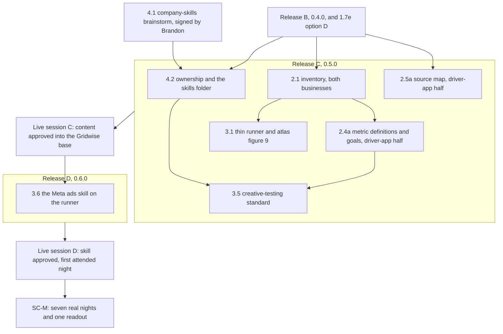
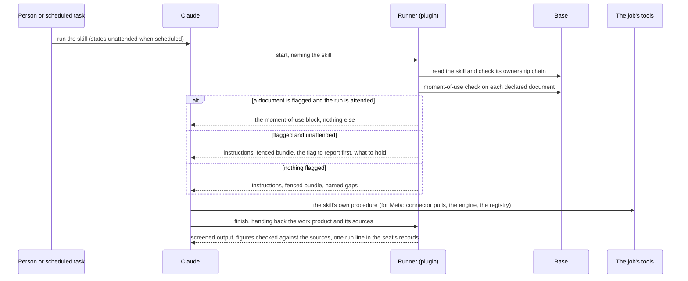

# feat: Plan 1 of Phases 2 and 3, company skills and the Meta ads skill on the base

**Target repo:** `gtm-base` (this repository). Plan 1 takes GTM Base from a base that holds context to a base that a real, daily skill reads before it works. It follows Brandon's decisions of 2026-10-10 (`docs/plans/2026-10-10-001-phase-2-3-decisions.md`), which replace call 48 of the build plan: the first skill is the Meta ads creative-testing skill already in daily use for the Gridwise driver app, not the outbound sequence, and the company-skills brainstorm runs and is signed off before that skill is built on the base.

## Overview

Plan 1 is the part of Phases 2 and 3 that can be planned now. Plan 2 (messaging, voice, design, product, buyer personas, updating GTM Base, drift grade and content brief) is written after the Meta skill has run on real nights, because those nights decide what the kinds and the standards need to hold (decision D4).

Plan 1 holds eight units, in this order:

| Unit | What it delivers | Code? |
|---|---|---|
| 4.1 | The company-skills brainstorm, built on Brandon's ownership model (D5), signed off by Brandon first | No, a document |
| 4.2 | Ownership and the skills folder, built from the signed brainstorm | Yes |
| 2.1 | The base inventory, across both businesses (D1) | Yes |
| 3.1 | The thin runner, its contract test, and one new atlas figure for it (D8) | Yes |
| 2.4a | Metric definitions and goals, the driver-app half (M6, M7) | Yes, and base content |
| 2.5a | The source map, the driver-app half (M8) | Yes, and base content |
| 3.5 | The creative-testing standard, `standards/meta-creative-testing.md` (M12 option A) | Yes, and base content |
| 3.6 | The Meta ads skill running through the runner, with the `mads` engine left installed outside the base | Yes, and base content |

Units 4.1, 2.1 and 3.1 keep their roadmap numbers. Units 2.4a and 2.5a are the driver-app halves of roadmap Units 2.4 and 2.5; their Analytics halves move to Plan 2. Units 4.2, 3.5 and 3.6 are new.

The line from this work to pipeline is the Meta skill's own line, and Plan 1 is honest that it does not shorten it. The skill exists to buy account links more cheaply at the same spend, which puts more linked drivers into trials and more trials into paying subscribers. What the base adds is that the skill reads Brandon's real business goals and metric definitions before it judges anything, says how each engine threshold relates to a goal, and gets flagged when a goal changes. The success test (SC-M, proposed below, Brandon's to decide) proves the base is in the loop on real nights. It does not claim cost per account link moved, and the plan says so wherever it could be read that way.

## Problem Frame

**The first skill changed, and the reason matters.** Call 48 pulled the outbound sequence forward because it was the shortest line to pipeline. On 2026-10-10 Brandon chose the Meta skill instead because it is the one in daily use (D2). A skill that already runs every night is a better first test of the base than one that would be written for the test, because real use is what finds the defects: every defect in Amendment r2.4 was found by a person using the product, and none by the tests (`docs/plans/2026-09-19-001-feat-base-that-produces-work-plan.md`, Institutional Learnings).

**The Meta skill today knows nothing about the business goals.** Verified by reading `~/.claude/skills/meta-ads/` and `~/Gridwise/meta-ads/` on 2026-10-10. The engine judges creative against its own thresholds in `config.toml`, written as targets per platform. Those thresholds are deliberately not the business goals Brandon gave in M7: Brandon chose option A for M12 because the engine reading its targets from the goals would kill every web creative. Nothing anywhere says how the two relate, so a reader of the Monday readout sees an engine verdict without the goal it serves. Some results the engine reads are Meta's own counts of an event, while the goals are measured on counts kept in other tools, so even where the names match the numbers are different numbers. A standard that relates each threshold to a goal, and metric definitions that say which count is which, are exactly what a base is for.

**The base cannot hold any of this yet.** Verified on the release-b branch (94c9343) and the Release B finish branch (3f9f4f5):

- `base_reader.context_files` walks only `context/`, so a standard under `standards/` or the source map at `access/stack.md` is never read, owned, confirmed or flagged.
- `layout.is_refused_in_skills` refuses every file under `skills/` except an empty placeholder, by every path (`trust_surface.CODE_SKILLS_FILE`, `write_hook.CODE_SKILLS_FILE`), until the company-skills brainstorm settles who may approve a skill change (call 13).
- `approve_local._owner_problems` lets only an address on a file's own `owner:` line approve a change to it. There is no base owner or administrator role anywhere in the code, which Brandon's model needs (D5).
- Proposals reach `context/` only (call 43).
- No runner exists, and no skill reads the base.
- The Gridwise base (`~/GTM Bases/Gridwise/gtm-base`, read on 2026-10-10) is on the older layout, holds the Analytics customer profile and positioning, and its profile's first paragraph says it covers Analytics and not the driver app. D1 puts both businesses in one base.

**Who may change a skill is the hard question, and Brandon answered it.** Whoever creates a skill or a context document owns it. A change may be made and approved by its owner, or by the base's owner or administrator, and nobody else, and ownership has to be provable, not claimed (D5). Unit 4.1 works out how that is recorded and proven; Unit 4.2 builds it.

## Requirements Trace

Plan 1 carries four requirements the build plan moved to the roadmap (P30, P31, P33, P34), keeps the standing rule P35, and adds P39 to P44. Numbering continues the build plan's so a requirement means one thing in every document.

| Id | Requirement | Source |
|---|---|---|
| P30 | A base inventory answers "what is my base missing?" against a named list of kinds, for each business the base covers, and adopts or drafts each on request. Setup stays at two documents. | Brandon 2026-09-19; D1 |
| P31 | The source map says, for each kind of data, where it lives outside the base, which connected tool reads it, and the fallback. Context reads stay local, and nothing reads a source at context-loading time. | Brandon 2026-09-19; M8 |
| P33 | A skill that uses the base is a thin runner over files in the base: it declares what it reads, every declared document passes the moment-of-use check, its rules live in a standard, and it has owner-approved examples checked by a contract test. Revised by D2: a skill may also call the tools its job needs, as listed in the source map; the runner itself never calls any tool. | Brandon 2026-09-19; D2 |
| P34 | Company skills shared across seats get a brainstorm whose deliverable is a requirements document, signed off by Brandon before the first company skill is built. | Brandon 2026-09-19; D2, D5 |
| P35 | Nothing is written outside the base, the plugin's own records folder, and a configured hooks directory. No MCP servers are declared. The logic atlas changes in the same change as the code. No invented number or timing appears anywhere. | Standing rule |
| P39 | Whoever creates a skill or a document owns it. A change to it may be made and approved only by its owner, the base's owner, or an administrator of the base. Ownership is proven from what the base records (the owner line, the saved history, the seat's address), and every approval also passes Unit 1.7e's proof that a person said yes. | D5 |
| P40 | One base can cover more than one business. Each document says which business it is about, or that it is about the whole company, and the inventory, the moment-of-use check and ownership work per document, so a change to one business never interrupts work on the other. | D1 |
| P41 | A standard holds a job's rules in plain words and holds no figure. A number lives in exactly one place: a business goal in the goals document, an engine threshold in the engine's settings. The standard names each threshold, says which goal it serves and why it differs, and says where the number lives. | M12 option A |
| P42 | The Meta ads skill runs through the runner from the Gridwise base. Its written instructions and its standard live in the base; its engine (`mads`, written in Python) stays an installed tool outside the base, and so do its settings and its run data. | D2, D5, M12 |
| P43 | A run can be stated as unattended. An unattended run never approves anything, never asks a question, and never stops spend-protecting work because a document it reads for meaning is flagged; it reports the flag first instead. Whether a run is unattended is stated by whoever starts it and never inferred. | Plan 1, call 3 below |
| P44 | Confidential client material never enters this repository. Fixtures are synthetic. The walkthrough for the success test records what happened without spend figures, account or campaign identifiers, or creative names, because this repository is public (verified with `gh repo view` on 2026-10-10). | Lesson of 2026-09-20; P44 is new |

### Success criteria

**SC-M, the Meta skill ran on the base (proposed; replaces SC-C for Plan 1; Brandon decides, call 2).** Seven consecutive real nights of the Meta daily check run through the runner from the Gridwise base, in whatever mode the engine's settings set (Plan 1 never changes the mode), with `mads decide` running on each night. For each night the record shows that the runner read the creative-testing standard, the driver-app goals and the metric definitions, ran the moment-of-use check on each, named any gap, and changed no engine input or output. Inside the same seven nights, one Monday readout is drafted through the runner, states for each rule that fired which goal it serves in the standard's words, and is used by Brandon in the Demand Gen weekly meeting. The walkthrough record says which nights ran, which were missed and why, any night the runner got in the way, what Brandon changed in the readout before using it, and whether any context change flagged a document the skill reads. If no real goal or threshold change happens in the window, the record says so, and the flag path is proven by the contract test instead of by a staged change. What SC-M does not prove: that cost per account link fell. The readout already reports cost per account link against the goal; Plan 1 does not claim the base moved it.

**SC-C stays parked** with the outbound sequence (roadmap Unit 3.4, as the reviewed Unit 1.4c text), which is no longer the first skill (D2). Its test is unchanged for whichever plan builds it.

**SC-A, the new computer test, partly.** Everything Plan 1 adds to the base travels in the base: goals, metric definitions, the source map, the standard, and the skill's instructions. The engine does not, by design (P42), so a new computer also needs the engine installed. The source map lists the engine as a tool the job needs, so a person setting up a new computer can see what to install rather than discovering it on the first failed night.

**SC-B, the vacation test, the context half.** The nightly check already runs while Brandon is offline, on Claude Code's own scheduler. GTM Base builds no scheduler (unchanged scope boundary). What Plan 1 adds is that an unattended run reads its context from the base alone, with no person carrying context in, which is the half of the vacation test that is a context problem.

## Scope Boundaries

- **No scheduling in GTM Base.** The nightly check runs on Claude Code's scheduled tasks, which Brandon owns. Plan 1 changes the scheduled task's prompt and tool list only as an exact difference shown to Brandon and applied on his yes.
- **No script files in a base.** Unit 4.1 answers the question (below) and the answer is no, for Plan 1 and until the conditions it names exist. The trust-surface refusal of `CLAUDE.md`, `AGENTS.md`, `plugins/`, `.claude/`, and every `.sh`, `.py` and `.js` file in a base stands.
- **Nothing under `~/Gridwise` is edited.** The engine, its `config.toml`, its README and its tests are read only. One sentence in the engine README that will go stale (where the skill lives) is listed for Brandon, not changed by a builder.
- **No change to the engine's thresholds or mode.** A threshold changes only when Brandon decides it should (M12). Plan 1 never sets `pausing_enabled`.
- **No Analytics halves.** Analytics metric definitions, goals and sources (the other halves of M6, M7 and M8) and call 54's offer to move pipeline state out of the twelve adopted Gridwise pages move to Plan 2, which is where the Analytics documents are worked.
- **No second seat, no shared copy, no backup.** Ownership is built and proven for a base with no shared copy, which is every base that exists. The shared-copy half of the proof is designed in the brainstorm and built with backup.
- **No auto-apply, and no AI-initiated skill edits.** The AI proposes and an owner approves. The step where the AI proposes an edit to a skill after using it is on request only in Plan 1.
- **No lessons from results yet.** The Meta skill is the first reporting skill, which is where `learning/lessons/` is meant to start filling. That waits for Plan 2, because Plan 2 is written from the real nights and the lessons are what those nights teach.
- **No MCP servers declared** in the plugin manifest, unchanged.

## Context & Research

### Relevant Code and Patterns

Every path below was read for this plan on the release-b branch (94c9343) or the Release B finish branch (3f9f4f5), because main does not yet carry the Release B layout. Release B ships as 0.4.0 (call 51).

- **The layout constants**, `plugins/gtm-base/lib/gtmbase/constants.py`: `ACCESS_DIR`, `SKILLS_DIR`, `STANDARDS_DIR`, `LESSONS_DIR`, `STACK_PATH` (`access/stack.md`), `LAYOUT_EMPTY_FOLDERS`, `REQUIRED_CONTEXT_FILES`. Every unit adds to it append-only, per the lesson of 2026-09-05.
- **The skills refusal**: `layout.is_refused_in_skills`, `layout.is_the_skills_placeholder`, `layout.placeholder_is_empty`, `layout.names_a_skill_file`, used by `trust_surface.py` (`CODE_SKILLS_FILE`, "skills-folder-not-empty") and `write_hook.py` (`CODE_SKILLS_FILE`, "in-a-bases-skills-folder"). Unit 4.2 narrows these and nothing else.
- **Ownership today**: `review.stamp_owner` and `create_base.stamp_owner` write the `owner:` line at creation; `validate.validate_owner` parses it; `approve_local.owners_of` reads it from the saved version, never the working copy (finding M5 of the third look); `approve_local._owner_problems` refuses a change unless the seat's address is an owner of every file it touches; `base_reader.accepted_by` reads who brought a file onto the shared line of work from the first-parent history. Unit 4.2 builds on all of them.
- **The approval proof**: Unit 1.7e as rebuilt by call 57, option D: every approval is confirmed through Claude Code's own permission prompt, forced by a plugin hook answering "ask". The sibling session's notes of 2026-10-10 record that in non-interactive mode a forced "ask" is denied with the reason returned to Claude, and that it was not verified live in auto or bypass mode. So an unattended run can never pass an approval, which P43 relies on.
- **The reader and the check**: `base_reader.read_base`, `base_reader.context_files`, `stale.compute`, and `moment.check(base_root, base_id, path, session_id, runner, now)`, which is a local lookup that writes nothing into the base and returns a `Moment` with `flagged`, `fix_ready`, `staging_path` and `owned`. `moment.context_path_of` accepts paths under `context/` only today.
- **The two ends of a pipeline the runner reuses**: `drafting.assemble` and `review.screen`, plus `compose_proposal.scan_everything` for contact details and keys, and `sources.fence` for the data-not-instructions fence.
- **Proposals**: `compose_proposal.py` (section addressing by heading, `load_staging`, `check_edits`, `apply_edit`), `approve_local.py` (the local half of review), `propose-change/references/local-approval-rules.md`.
- **Names**: `names.document_name` is the one place a path becomes a name a person reads. Every new kind and every business folder gets its human name there.
- **The templates**: `templates/company-base/` and its plugin copy, held identical by `tests/test_scaffold.py`. The template already carries `access/stack.md` as a prose starter with three sections and no rows (Unit 1.5b, call 42), and its `CODEOWNERS` already lists `skills/**` and `standards/**` for the owner's review.
- **The atlas**, `docs/diagrams/logic-atlas.html`, eight figures today, from "1. Where things live" to "8. Confirmations and the stale rules".
- **The Meta skill**, read only: `~/.claude/skills/meta-ads/SKILL.md` and its five references (`rules.md`, `daily-check.md`, `mcp-cookbook.md`, `notion-registry.md`, `launch-settings.md`); `~/Gridwise/meta-ads/README.md` and `config.toml`; `~/Gridwise/docs/plans/2026-10-05-001-feat-meta-ads-skill-plan.md`. The engine makes no network call; Claude fetches through the Meta Ads connector, saves each response, and the engine turns files plus `config.toml` into decisions, a pause plan, registry rows and a summary. `rules.md` carries the thresholds as numbers, copied from `config.toml`, which is the duplication M12 option A ends.
- **The nightly schedule**, read only: `~/.claude/scheduled-tasks/meta-ads-daily-check/SKILL.md` runs at 00:15 Eastern in collect mode today (pulls and ingest, no `decide`, no registry, no pauses), with a fixed tool list: three read tools from the Meta Ads connector and Bash limited to the engine command.
- **Codex as a builder**: `~/.claude/tools/codex-copy.sh` runs `gpt-5.6-sol` at high reasoning in a read-only sandbox and prints only Codex's answer. It cannot write files, which shapes how Sol builds (call 5).

### Institutional Learnings

From `tasks/lessons.md` and the Release A and B reviews.

- Two agents editing shared modules at once need explicit file ownership and append-only constants. Plan 1 runs Opus and Sol builders side by side, so each unit names the files it owns.
- A gate that allows what it cannot parse fails open. Every new allowance under `skills/` is an allow-list of exact shapes, refusing everything else.
- A hook matcher is a list of tool names, so a check declared on one tool has a hole the width of every other tool. Unit 4.2's write refusals cover every tool the existing write hook covers, and the security pass looks for the rest.
- Test the command a skill tells the assistant to run, taken from the skill's own text. Unit 3.6 tests the runner commands as written in the base skill and the scheduled prompt.
- A happy path that passes because a fake stands in for the real thing proves nothing. Unit 4.2's chain check is tested on a base made the way `create_base` makes one, with real history.
- A fix to a safety rule is new code and needs its own outside look. Units 4.2 and 3.1 each get their own Astra pass before their release, not only the release pass.
- Never write a client's file names into a public repository. P44 extends that to spend, identifiers and creative names.

### External References

- Claude Code skills and plugin skill discovery, scheduled tasks, and hook "ask" behavior per permission mode, as recorded in the sibling session's notes of 2026-10-10 and the earlier plans. Not re-verified here; Unit 3.6 verifies the scheduled-run behavior it depends on live, on night one.

## Key Technical Decisions

| Decision | Rationale | Rejected alternative |
|---|---|---|
| **The brainstorm is answered in this plan and signed in its own document.** Unit 4.1's section below gives a proposed answer to each of its questions, and the brainstorm document formalizes them for Brandon's signature. Unit 4.2 is written to those answers. | The build plan's practice: a plan is written to the recommended answer so the build does not wait, and a different answer changes the named unit only. A brainstorm with no proposed answers would be a second round of questions, which the roadmap's verification line forbids. | An open brainstorm with no proposals; skipping the brainstorm because the first skill has a single owner (D2 says it runs first). |
| **Approval authority is a set computed per document: its owners, the base owner, and the administrators.** The base owner is the map's `owner:` line. Administrators are a new `administrators:` line in the map's settings block, changed only by the base owner. | The map is the one document the whole team shares and the base owner already owns, it is never asked about (P12), and its settings parser has range checks to extend. Keeping the roles beside the settings means one place to read authority from. | `CODEOWNERS` as the source (it names GitHub handles, not the addresses everything else uses, and exists only to drive GitHub); a new roles file (one more document to own and keep in step). |
| **Ownership is proven by a chain read from the saved history, checked by the seat that uses the document.** A document's ownership is valid when the change that created it was made by the address on its first owner line, and every later change to an owner line, to the map's `owner:` line, or to `administrators:` was made by someone then allowed to make it. The plugin checks the chain before it runs a skill and in the review, and a broken chain refuses the skill and names the document. | Brandon's "provable, not claimed" (D5). A check made by the reader works whatever the hosting plan allows, which answers the brainstorm's question about enforcement on a plan with no branch protection. On a base with one seat the chain is trivially valid; the check is what makes a second seat's edit safe later. | Trusting the owner line alone (anyone who can save a file can rewrite it); requiring signed commits now (heavy for a non-technical team, and nothing to verify against until a shared copy exists). |
| **Every approval needs both proofs: a person said yes (Unit 1.7e), and that person may (P39).** The seat's address must be in the authority set, and the forced permission prompt must be answered. | The two answer different questions. 1.7e proves presence, ownership proves authority. Either alone is spoofable in an obvious way. | Ownership alone; the prompt alone. |
| **The skills folder accepts written instructions in exact shapes and nothing else.** `skills/<job>/SKILL.md`, `skills/<job>/references/*.md` and `skills/<job>/examples/` holding markdown and plain text. Everything else under `skills/` stays refused by every path, as today. A skill's settings block may not carry keys that grant power in Claude Code, such as allowed tools or hooks. | A script runs on every teammate's computer; a written instruction is read by an assistant that still asks before acting. The shapes are an allow-list because a gate that allows what it cannot parse fails open. Power-granting keys would turn an instruction file into a permission change. | Lifting the refusal for the whole folder; allowing scripts with a review step. |
| **A base skill reaches Claude through the core plugin, not by copying.** Session start adds one line per approved skill to what it injects (the skill's name and its one-sentence description, as data), and a plugin skill runs any base skill through the runner. | Claude Code finds skills in a person's own folder, a project's folder, or a plugin, and a base folder is none of these. Copying a skill into a person's folder would write outside the base (P35). One line per skill keeps the injection small. | The base as its own plugin marketplace (heavy for one skill, and every update becomes a plugin release); copying into `~/.claude/skills`. |
| **The runner reads; it never decides and never calls a tool.** It reads the declared documents, runs the moment-of-use check on each, fences them, hands back the skill's approved instructions with the bundle and the named gaps, and screens what the skill hands back. The skill's own procedure calls its tools (for Meta: the Meta Ads connector, the registry, the engine command). | This keeps P33's thin-runner shape while letting a real skill do real work, and it keeps the base's promise that context reads stay local. It revises one line the build plan resolved ("a skill that uses the base may read a source tool: no"), which was written before the first skill was a reporting skill (D2). | The runner calling tools for the skill (puts network calls in the plugin); the skill reading the base itself (every skill would have to remember the moment-of-use check). |
| **A standard holds no figure, and a screen enforces it.** A standard's body may contain a date and no other digit. | P41, and it is the only rule that keeps a threshold from living in two places. A mechanical rule is testable and cannot drift; "do not restate numbers" in a prompt is a hope. | A prompt-only rule; allowing figures with a "source:" note (the duplication returns the first time someone edits one copy). |
| **Two businesses are two folders under `context/`, listed in the map.** Recommended answer to call 1: `context/<business>/` holds that business's versions of the kinds that differ by business, the flat files hold whole-company documents, and the map's settings list each business's slug and name. Plan 1 creates only `context/driver-app/`. | Ownership (P39), the moment-of-use check and the review all work per file, so a file shared by two businesses would let a change about Analytics interrupt the Meta nightly run, and would let only one person own both halves. The segments pattern (`context/icps/<slug>.md`, call 11) is the precedent. | One file per kind with a section per business (runner-up in call 1). |
| **The Meta skill's thresholds stay in the engine; the base holds the goals (M12 option A).** This departs from roadmap Unit 2.4's line that targets stay in the model and the base holds only the judgment: Brandon decided the base holds the business goals themselves. | Brandon's decision. The goals document is where a goal is a figure; the standard says how each engine threshold relates to one, in words. | The engine reading its targets from the goals (rejected by Brandon: on the web it would kill every creative). |
| **Unattended runs report a flag instead of stopping (recommended answer to call 3).** | The nightly check protects spend, its decisions come from `config.toml` and never from the base, and stopping it because a goals document is flagged would leave test spend unwatched for a night. What does read the flagged document's meaning (the readout's goal comparisons) is held until Brandon chooses. | Stopping the whole run until he answers. |

## Execution Posture

**Builders (D9).** Units are split between Opus builders (Claude Opus 5.5 at high effort, one unit per agent) and Sol builders (`gpt-5.6-sol` through `~/.claude/tools/codex-copy.sh`). Astra (`gpt-6-astra`, through the Codex CLI from a script file, read only) stays the outside review.

| Unit | Builder | Why |
|---|---|---|
| 4.1 | Opus, with Brandon | A design conversation and a document Brandon signs |
| 4.2 | Opus | Security: it narrows the trust-surface refusal and touches the write hook and local approval |
| 2.1 | Opus | It widens what the base reads (reader, stale computation, moment-of-use, names), which every later unit stands on |
| 3.1 | Opus | It fixes the contract every skill is built against, and its moment-of-use and unattended paths are judgment calls |
| 2.4a | Opus | Drafting prompts whose whole value is in the wording and in asking rather than inferring |
| 2.5a | Sol | A parser and validator over a fixed table shape, with a closed test list |
| 3.5 | Sol | A new kind, a mechanical no-figure screen and a drafting prompt modelled on 2.4a's; the orchestrator reads the prompt's wording against `docs/ux-standard.md` before merge |
| 3.6 | Opus | It moves a live skill, touches Claude Code skills, scheduled tasks and connectors, and carries the success test |

How Sol builds is call 5. By default the brief for a Sol unit is self-contained (the unit text, the files it owns in full, the tests it must pass), Sol returns one patch, and the orchestrator applies it in the unit's worktree, runs the suite and the lint, and sends failures back in the next brief. Sol never writes to a checkout.

**Order and parallel tracks.** Unit 4.1 starts now: it is a document and does not wait for Release B. After Brandon signs it and Release B ships, three tracks run at once, with these file owners: 4.2 owns `ownership.py`, `layout.py`, `trust_surface.py`, `write_hook.py`, `approve_local.py` and the proposal path; 2.1 owns `inventory.py`, `base_reader.py`, `stale.py`, `moment.py` and `names.py`; 2.5a owns `truth_map.py`. Unit 3.1 starts when 2.1 has merged, because the runner checks documents the widened reader reads. Unit 2.4a follows 2.1, 3.5 follows 2.4a and 4.2, and 3.6 follows everything. `constants.py`, `tests/support.py` and `tests/plain_language.py` are append-only for every unit.

**The orchestrator** holds this plan and the suite, runs `sh tests/run.sh` and the plain-language lint after every unit, and merges only a unit whose test scenarios are all covered.

**Releases (recommended answer to call 6).** Two releases, each with one live session by Brandon (D3), not one per unit:

- **Release C (0.5.0):** Units 4.2, 2.1, 3.1, 2.4a, 2.5a and 3.5, which is the machinery plus the kinds the Meta skill reads. Live session C: Brandon runs the inventory on the Gridwise base, records the context change that the base now covers both businesses, and approves the driver-app goals, the metric definitions, the source map rows and the creative-testing standard. The content enters his base in that session.
- **Release D (0.6.0):** Unit 3.6. Live session D: Brandon approves the skill's instructions into the base, approves the scheduled task's new prompt, and watches the first night run through the runner while attended. The SC-M window starts on the next night.

The version numbers are proposals; the version is set at each bump.

**Reviews.** Astra reviews this plan before any build (this round). Astra and Fable 5.1 review the brainstorm document before Brandon signs it, as the roadmap set. Units 4.2 and 3.1 each get an Astra security pass and correctness pass before their release; each release then gets one security pass and one correctness pass over the whole. A fix to a finding gets a confirming pass (lesson of 2026-09-20).

**The dependency on Release B (0.4.0).** Plan 1's code starts from main after Release B has merged and shipped. It needs from Release B: the layout of Unit 1.5b (`skills/`, `standards/`, `access/`), the starter source map written into a moved base (call 42), the segment names kept where every seat can read them (call 59), and Unit 1.7e as option D (call 57). If 0.4.0 ships without 1.7e and D follows as 0.4.1 (call 58), Unit 4.2 does not ship before 0.4.1, because ownership composes with that proof; Units 2.1, 2.5a and 3.1 do not wait for it. Before live session C, Brandon moves the Gridwise base to the current layout through Release B's offered move.

**While the plugin is live in a build session**, its gate reads every Bash command: git on its own line, commits with a message file, Codex run from a script file, and the plugin's records folder never named on a command line.

## Open Questions

### Resolved During Planning

- **Whether script files may live in a base:** no. Unit 4.1 records why and what would have to be true to revisit it.
- **Where the Meta skill's instructions live:** in the Gridwise base, at `skills/meta-ads/`, owned by Brandon. Its engine, settings and run data stay where they are (P42).
- **Where the base owner and the administrators are recorded:** the map, as above.
- **Whether a skill may call a tool:** yes, the tools its job needs, listed in the source map; the runner calls none (revises the build plan's resolved question, per D2).
- **Whether the inventory drafts every missing kind in Plan 1:** no. It reports every kind for every business and offers to draft only the kinds with a drafting prompt in the release: goals, metric definitions, source map rows and a standard. For the rest it says drafting arrives later.
- **Whether standards and the source map go stale like context documents:** yes. Unit 2.1 makes them read, owned, confirmed and flagged, so a change to a goal can flag the standard that relates to it, which is the demonstration the product exists for.
- **What the runner records about a run:** one line per run in the seat's own records (job, date, attended or not, each document read with its content hash, flags, gaps), never in the base, because a nightly write into the base would need a nightly approval. The SC-M walkthrough is written from those lines and the engine's own summaries.
- **The Gridwise base's scope:** it becomes the whole company through a context change Brandon records in live session C, which flags the customer profile; the fix to its first paragraph goes through the proposal path.

### Deferred to Implementation

- The exact syntax of the map's `businesses:` and `administrators:` settings, decided by the builder of 2.1 and 4.2 respectively within the map's existing settings grammar, and read aloud in live session C.
- The size limit for a skill file and the folder depth under `skills/<job>/`, set by the brainstorm from the Meta skill's real files rather than picked here.
- Whether the Release B finish branch has added sentences or calls after call 59 that a Plan 1 unit must respect. Read at the start of each unit.
- How many example nights the Meta skill's examples need before the set is meaningful, decided when the first set exists.
- Whether a scheduled session loads the plugin's session-start injection and the base skill index. The Meta plan's night-one checks recorded the same kind of question for the connectors; Unit 3.6 records the answer on its first attended night and its first unattended night.

### For Brandon

New calls only where the decisions brief leaves something open. Plan 1 is written to the recommended answer on each, so the build does not wait. A different answer changes the named unit and nothing before it. The brainstorm's own answers (who approves, how it is proven, how ownership passes, distribution, examples) are not repeated here: Brandon's signature on Unit 4.1's document is the call on all of them.

| # | The call | Recommended (what Plan 1 assumes) | Runner-up | Needed before |
|---|---|---|---|---|
| 1 | How one base holds two businesses (D1 decided both; it did not decide how) | One folder per business under `context/` for the kinds that differ by business (`context/driver-app/goals.md`, `context/driver-app/metrics.md` in Plan 1), flat files for whole-company documents, and the map's settings listing each business. A change about one business never interrupts work on the other, and each half can have its own owner. The Analytics documents stay where they are until Plan 2 decides whether they move. Business names: "Gridwise Analytics" and "the driver app", slugs `analytics` and `driver-app` | One file per kind with a section per business. Simpler, but a change about Analytics goals flags the whole goals file and interrupts the Meta nightly run, and one person owns both halves | 2.1 is briefed |
| 2 | The success test that replaces SC-C | SC-M as written above: seven consecutive real nights with `decide` running, through the runner, plus one Monday readout used in the weekly meeting, recorded without confidential figures | One Monday readout drafted through the runner and used in the weekly meeting, recorded the same way. Faster, but one readout cannot show the nightly path holds | 3.6 is briefed |
| 3 | A document the skill reads is flagged during an unattended night | The engine's check runs as normal, because its decisions come from the engine's settings and never from the base; the summary leads with the flag, the document and the change; and the readout's goal comparisons are held until Brandon chooses | Stop the whole night until he chooses, leaving that night's test spend unwatched | 3.1 is briefed |
| 4 | The copy of the Meta skill in `~/.claude/skills/meta-ads` once the base copy is approved | It becomes a pointer of a few lines saying the skill now lives in the Gridwise base and runs through GTM Base, so two full copies never compete for the same request; after SC-M passes, Brandon moves it to `~/claude-archive/` himself | Brandon archives it on the day of the move | 3.6 is briefed |
| 5 | How a Sol builder writes code, given `codex-copy.sh` runs read only | Sol returns one patch through the read-only script; the orchestrator applies it in the unit's worktree, runs the tests, and sends failures back. Sol never writes to a checkout, and no new tool is added to `~/.claude/tools` | A sibling script that runs Sol with write access inside the unit's worktree. Faster rounds, but a second, writable Codex path to keep safe | The first Sol unit (2.5a) |
| 6 | One release or two | Two, as under Execution Posture: Release C is the machinery and the kinds, Release D the skill. Two live sessions, and a failure in the skill does not hold back the context work | One release and one longer live session | The first version bump |
| 7 | This repository is public (verified 2026-10-10), and the decisions brief, committed on this branch and not yet pushed, carries Gridwise figures: the driver-app goals in M7 and the pipeline figure from the Q4 objectives quoted in M7's proposed source | Before the branch is pushed, those figures in the decisions brief are replaced with "recorded in the Gridwise base on 2026-10-10". The names of the tools (the dashboard, Mixpanel, RevenueCat) stay, because they say nothing a competitor could use. Plan 1 itself carries no goal figure, threshold, spend, identifier or creative name | Push as written, accepting that the goals become public | The branch is pushed |

## High-Level Technical Design

> *This illustrates the intended approach and is directional guidance for review, not implementation specification. The implementing agent should treat it as context, not code to reproduce.*

### One run of a base skill

## Implementation Units

### Unit 4.1 runs first

- [ ] **Unit 4.1: The company-skills brainstorm**

**Goal:** A requirements document for company skills, built on Brandon's ownership model, answering every question below or saying why it is deferred, signed by Brandon before the Meta skill is built on the base. No code.

**Requirements:** P34, P39.

**Dependencies:** None. It starts now. The roadmap listed 3.1 and 2.5 as inputs; the runner's shape and the source map's shape are fixed by this plan, which is input enough.

**Files:**
- Create: `docs/brainstorms/2026-10-XX-company-skills-requirements.md`
- Create: `docs/reviews/2026-10-XX-company-skills-astra.md`, `docs/reviews/2026-10-XX-company-skills-fable.md` and their briefs

**Approach:** Run the brainstorm with Brandon, starting from the proposed answers below, with the trust posture of this repository as the constraint and the Meta skill's real files as the worked example. Each answer in the document says what Plan 1 builds from it and what waits for the shared-copy plan.

| Question | Proposed answer | What Plan 1 builds |
|---|---|---|
| **Who may approve a change under `skills/`** (the first question, answered by D5) | The skill's owner, the base owner, or an administrator, and nobody else. The same rule covers every document in the base: context documents, standards and the source map. | Unit 4.2 |
| **How ownership is recorded** | A document's `owner:` line, stamped at creation with the creating seat's address, as every document already is. The base owner is the map's `owner:` line. Administrators are a new `administrators:` line in the map's settings, changed only by the base owner. | Unit 4.2 |
| **How ownership is proven** | Three things together. The seat's address (the account state the seat was set up under) is in the authority set for the document. The forced permission prompt of Unit 1.7e was answered, so a person at that seat said yes. The saved history holds an unbroken chain: the change that created the document was made by the address on its first owner line, and every later change to an owner line or to the map's roles was made by someone then allowed to make it. The seat that is about to use a skill checks the chain, so the proof does not depend on the hosting plan. Stated plainly as a residual: on one computer, the seat's address is whatever that seat was set up with, and anyone using that computer is that seat. | Unit 4.2 (the local half) |
| **How the proof works on a shared copy** | Deferred to the backup plan, with the lead to verify then: history authorship can be written by anyone who can send changes, unless changes are accepted on GitHub itself. Whether GitHub's own signed merge records give a verifiable acceptor is inferred, not checked, and squash merges record the author rather than the person who accepted it (`base_reader.accepted_by` already says so). | Nothing; recorded |
| **How ownership passes when someone leaves** | The base owner or an administrator approves a change to a document's owner line, shown as a prepared change and recorded as a correction with the reason. The base owner role passes only by the base owner's own approval of a new map `owner:` line. If the base owner is gone and cannot approve, recovery is outside GTM Base (whoever controls the shared copy or the computer), and the document says so rather than inventing a back door. | Unit 4.2 (owner-line changes) |
| **How it fits Unit 1.7e** | Both proofs at every approval point. 1.7e answers whether a person said yes; ownership answers whether that person may. An unattended run can pass neither, because a forced "ask" with nobody there is denied. | Unit 4.2 |
| **Who may create a skill or a document** | Any joined person may create a context document and owns it. Creating a skill also needs the base owner's or an administrator's yes, because a skill is instructions every seat will run; the creator still owns it. Brandon decides by signing. | Unit 4.2 |
| **1. The trust model for code on every seat** | Written instructions only. A skill folder holds markdown and plain text in the exact shapes listed under Key Technical Decisions. Instructions still steer an assistant, so the defenses are who may approve them (P39) and showing a changed skill before it is used. | Unit 4.2 |
| **2. The pull refusal and the trust surface, path by path** | `skills/<job>/SKILL.md`, `skills/<job>/references/*.md` and `skills/<job>/examples/**` (markdown and plain text) become allowed on pull, on disk and through GTM Base's own approval path. Direct writes by a file tool stay refused: a skill changes only through a prepared change. Links, executable files, hidden files, other extensions, deeper folders and power-granting settings keys stay refused. `CLAUDE.md`, `AGENTS.md`, `plugins/` and `.claude/` stay refused unchanged. When a pulled skill changed since this seat last ran it, the next attended run shows who changed it, when and what, before it runs. What an unattended run does with a skill changed by someone else is deferred to the shared-copy plan, with the two options recorded (refuse, or run the last version this seat ran); with one seat, every change is the seat's own. | Unit 4.2 |
| **3. Review and ownership on a plan with no branch protection** | The chain check by the seat that uses the skill, above. | Unit 4.2 |
| **4. Distribution** | Through the base, delivered by the core plugin: one injected line per approved skill and a plugin skill that runs any base skill through the runner. Not a marketplace, and never copied into a person's own skills folder. | Units 3.1, 3.6 |
| **5. Examples as tests** | A skill carries at least one example with an expectations file and one deliberately wrong output before it can be approved into a base, and the runner's contract check runs them on every proposed change before the approval is shown. No model is called; judgment is tested by the owner reading a real replay. | Units 3.1, 3.6 |
| **6. Update after a session** | Propose-a-change applied to skills and standards. In Plan 1 it is on request only. The AI proposing an edit on its own after each run waits for Plan 2, because the real nights are what show which edits are worth proposing. | Unit 4.2 (the path); Plan 2 (the habit) |
| **7. Audits for stale and duplicate skills and rules** | Deferred. One skill exists, so there is nothing to compare. The trigger to build it is the second company skill. | Nothing |
| **8. The vacation test and scheduling** | GTM Base builds no scheduler. Scheduled runs belong to the client's own scheduler, and the runner supports a run stated as unattended (P43). | Units 3.1, 3.6 |
| **Whether script files may live in a base** | No. A script in a shared base runs on every teammate's computer with that person's permissions, and nothing in GTM Base can review what it does at run time. The Meta engine therefore stays an installed tool. To revisit, three things would have to exist first: code pinned or signed so a seat runs only a version someone approved, each seat's own consent per version, and an answer to where it runs (Claude Code's sandbox or nothing). | Nothing; the refusal stands |
| **Whether the brainstorm may reopen the trust-surface refusal set** (roadmap open question 7) | Yes, narrowly: the markdown shapes under `skills/` and nothing else. | Unit 4.2 |

**Test scenarios:** None. The deliverable is a document. Its acceptance is a review by Astra and by Fable 5.1, fixes folded in, and Brandon's signature recorded in the document with the date.

**Verification:** The document can be handed to the builder of Unit 4.2 and produce that unit's work without a second round of questions, and Brandon has signed it.

**Atlas: none.** A brainstorm changes no behavior.

### Release C: the machinery and the kinds the Meta skill reads

- [ ] **Unit 4.2: Ownership and the skills folder**

**Goal:** A base enforces Brandon's ownership model on every document, proves it from the saved history, and accepts written skill instructions under `skills/` in exact shapes, while refusing everything else it refused before.

**Requirements:** P39, P34, P35.

**Dependencies:** Unit 4.1 signed; Release B with Unit 1.7e as option D (0.4.0, or 0.4.1 if call 58's time limit applied).

**Files:**
- Create: `plugins/gtm-base/lib/gtmbase/ownership.py` (the authority set for a document, the chain check over the saved history, owner-line and roles changes), `tests/test_ownership.py`, `tests/test_skills_folder.py`
- Modify: `plugins/gtm-base/lib/gtmbase/approve_local.py` (`_owner_problems` asks `ownership` instead of reading owner lines alone), `layout.py` (`is_refused_in_skills` allows the exact shapes), `trust_surface.py`, `write_hook.py` (direct writes under `skills/` stay refused; GTM Base's own approval path may write there), `compose_proposal.py` and `plugins/gtm-base/skills/propose-change/` (a prepared change may target `skills/<job>/`, `standards/<job>.md` and `access/stack.md`, closing call 43, and a document's settings block for an owner-line change), `formats.py` and `validate.py` (the map's `administrators:` setting; a skill's settings block with refused keys), `confirm.py` (confirmations for standards and the source map), `docs/plans/2026-09-19-001-acceptance-matrix.md` (rows for a skill: approved, changed since this seat last ran it, refused for a broken chain), `plugins/gtm-base/CHANGELOG.md`
- Test: `tests/test_approve_local.py`, `tests/test_trust_surface.py`, `tests/test_write_hook.py`, `tests/test_compose_proposal.py`, `tests/test_scaffold.py`

**Approach:** One module answers "may this address approve a change to this path, and is the record behind that answer intact?". The authority set is the document's owners from its saved version, plus the map's `owner:`, plus the map's `administrators:`. The chain check walks the history of the document and of the map, along the first parent of the base's own line of work, and accepts only when every owner-line and roles change was made by an address that held authority at that point. Local approval, the review and the runner all call it. The skills refusal becomes an allow-list of exact shapes; every path that refuses today (an update from the shared copy, a file on disk when the base is opened, a file-writing tool, a send) keeps refusing everything outside it. Nothing here weakens what may leave the computer.

**Execution note:** Test-first against hostile fixtures, one per clause, as Unit 1.7c did. A clause with no failing fixture is not built.

**Patterns to follow:** `trust_checkout` in `tests/support.py` for hostile bases; `approve_local.owners_of` reading the saved version; the absent-only write with `lexists`.

**Test scenarios:**
- Happy path: the owner of a document approves a prepared change to it; the base owner approves a change to a document owned by someone else; an administrator does the same.
- Security: an address that is neither owner, base owner nor administrator is refused, and the refusal names the document and who may approve it.
- Security: an owner line rewritten in a change made by a non-owner breaks the chain; local approval, the review and the runner each refuse and name the document.
- Security: an administrator adding another administrator is refused; the base owner doing it is accepted; removing the last base owner line is refused.
- Security: an approval with the right address but no answered permission prompt is refused (1.7e), and an approval in a run with no person (the prompt denied) writes nothing.
- Security: under `skills/meta-ads/`, `SKILL.md`, a reference and an example are accepted; a `.py`, a `.sh`, a link, an executable markdown file, a hidden file, a file two folders deeper than allowed, and a `SKILL.md` whose settings carry an allowed-tools or hooks key are each refused, on pull, on disk and through a file tool.
- Security: a direct write to `skills/meta-ads/SKILL.md` by a file tool is refused, and the same change through a prepared change and an approval is applied.
- Integration: an owner-line change for a person who left is shown as a prepared change, approved by the base owner, and recorded as a correction with the reason.
- Integration: a base made by `create_base` with real history passes the chain check with no seat-local state involved; the same base on the older layout is read the same way.
- Integration: proposals to `standards/meta-creative-testing.md` and `access/stack.md` go through the same screens, evidence, confirmation and correction record as one to `context/`.

**Verification:** In live session C, Brandon approves a change to a document he owns, sees a fixture change by a non-owner refused with a sentence he understands, and can say who may approve a change to his skill.

**Atlas: figures 1 and 6** (where things live gains the skills folder's shapes; what the safety check reads gains the allow-list).

- [ ] **Unit 2.1: The base inventory, across both businesses**

**Goal:** A person can ask "what is my base missing?" and get a short table against a named list of kinds, for each business the base covers, with the offer to draft each kind this release can draft.

**Requirements:** P30, P40, P28.

**Dependencies:** Release B. Call 1 answered (Plan 1 is written to the recommended answer).

**Files:**
- Create: `plugins/gtm-base/lib/gtmbase/inventory.py`, `plugins/gtm-base/skills/stale-check/references/base-kinds.md`, `tests/test_inventory.py`
- Modify: `plugins/gtm-base/lib/gtmbase/constants.py` (`BASE_KINDS`: ordered, each with its path pattern, whether it differs by business, adoptable, draftable in this release), `base_reader.py` (read `standards/*.md` and `access/stack.md` as base documents: owned, confirmed, flagged; the map stays excluded), `stale.py` and `moment.py` (`context_path_of` accepts those paths), `names.py` (human names for business folders and the new kinds), `formats.py` (the map's `businesses:` setting), `stale_check.py` and `plugins/gtm-base/skills/stale-check/SKILL.md` (the question, and the inventory as part of the review), `plugins/gtm-base/CHANGELOG.md`
- Test: `tests/test_stale_check.py`, `tests/test_base_reader.py`, `tests/test_moment_of_use.py`, `tests/test_scaffold.py`

**Approach:** `BASE_KINDS` is, in order, the nine kinds of the context standard (goals, product, ICPs with segments, buyer personas, positioning, messaging, voice, design, metrics), the source map, and the standard kind (`standards/<job>.md`: a job's goal, what is unacceptable, what needs approval, the checks before work is handed back, and how any threshold set elsewhere relates to a goal). The inventory is a read over the widened reader against that list, per business named in the map, returned as one small table: the kind, the business, whether the base has it, and when it was last confirmed. A flat file counts for the whole company. It offers to draft only what this release can draft and says "drafting arrives later" for the rest. It writes nothing on its own. When the map lists a business that the customer profile's first paragraph or its `covers:` line leaves out, the inventory names that and offers to record the context change, which is how the Gridwise base's scope moves to both businesses in live session C. Widening the reader is the larger half of this unit: once standards and the source map are read, owned and flagged, a context change to a goal can flag the standard that relates to it.

**Patterns to follow:** The review's one-list-in-one-sitting shape; the map-settings-and-reference pattern; the segments pattern for a folder of documents under `context/`.

**Test scenarios:**
- Happy path: a base with the two setup files and a map naming two businesses reports the other kinds as missing for each business, in the stated order, as one table.
- Happy path: a base holding `context/driver-app/goals.md` reports it present for the driver app with its last confirmation date, and missing for Analytics.
- Edge case: a kind present with an unanswered marker is present and not confirmed; a kind with `status: skipped` is skipped; an unreadable file is unreadable and does not make the kind missing.
- Edge case: a map with no `businesses:` setting reports one column for the whole company, exactly as a one-business base did before.
- Edge case: a map naming a business the customer profile says it does not cover produces the scope finding and the offer, and writes nothing.
- Integration: a context change affecting `context/driver-app/goals.md` flags that file and leaves `context/goals.md` and any Analytics file unflagged.
- Integration: a context change affecting `standards/meta-creative-testing.md` flags it, the review lists it, and `moment.check` on its path returns the block.
- Integration: every entry in `BASE_KINDS` has a section in `base-kinds.md` and every section an entry.
- Lint: every new sentence passes `tests/plain_language.py` and is registered when it lives in Python.

**Verification:** In live session C, Brandon asks the question on the Gridwise base and gets a table he can act on without a follow-up question.

**Atlas: figures 1 and 8.**

- [ ] **Unit 2.5a: The source map, the driver-app half**

**Goal:** For each kind of data the driver app's work needs, the source map says where it lives, which connected tool reads it, and the fallback, in rows a skill can read. Nothing reads it over the network.

**Requirements:** P31, P40, P35.

**Dependencies:** Release B (the starter `access/stack.md`); Unit 4.2 for changing it through a prepared change.

**Files:**
- Create: `plugins/gtm-base/lib/gtmbase/truth_map.py` (parse and validate the rows; never calls anything), `plugins/gtm-base/skills/join/references/prompts/draft-stack-rows.md`, `tests/test_stack.py`
- Modify: `plugins/gtm-base/lib/gtmbase/constants.py`, `plugins/gtm-base/skills/stale-check/references/base-kinds.md`, `templates/company-base/access/stack.md` and the plugin copy (the "Where the material lives" section gains the empty table with its five column names, and the prose stays), `plugins/gtm-base/CHANGELOG.md`
- Test: `tests/test_scaffold.py`, `tests/test_session_start.py`

**Approach:** One row per kind of data, five columns: the kind of data, which business it is for (or the whole company), where it lives, which connected tool reads it, and the fallback when that tool is not connected. A row naming a tool this seat has not connected is still valid, because the file is the team's record and not this seat's inventory. A base whose `stack.md` is still the prose starter has no rows yet, which is not an error. The rows the driver app needs in live session C, drafted from M8 and the Meta skill's own documents and confirmed by Brandon, are: spend (the paid media dashboard, confirmed in M8); trials, as the Mixpanel "True Trial" (M6); subscribers, payers and monthly recurring revenue (RevenueCat only, M6); account links (where they are counted for the goal, which nothing confirms yet, so it is a marker); Meta-reported results (the Meta ad account, read through the Meta Ads connector); the creative registry (the Notion Meta Creative Tests database, read through the Notion connector); and the engine itself as a tool the job needs installed. Which tool reads the paid media dashboard is also not confirmed, so it is a marker. No row carries a credential, and the existing source-map screen on file writes still applies.

**Patterns to follow:** The map's settings parser and its range checks; the rule that context reads stay local.

**Test scenarios:**
- Happy path: a well-formed table parses into rows with all five columns; a row missing its fallback is reported incomplete rather than accepted.
- Edge case: the prose starter with no table parses as no rows and no error.
- Edge case: a row whose business is not in the map's `businesses:` is reported, not dropped.
- Security: parsing makes no network call and no git call that reaches a remote, asserted with a runner that fails on any fetch.
- Security: a line shaped like a key or token is refused by the same screens a proposal gets.
- Edge case: session start injects the map and does not inject the source map.
- Integration: a prepared change adding a row is approved by the owner through Unit 4.2's path and the file is then confirmed and flagged like any other.

**Verification:** In live session C, Brandon can answer "where does our driver-app spend data live, and what reads it?" from the file alone.

**Atlas: figures 1 and 2.**

- [ ] **Unit 3.1: The thin runner, its contract test, and atlas figure 9**

**Goal:** One shape for every skill that uses the base, which is also the deterministic caller of the moment-of-use check, able to run a skill kept in a base and a run stated as unattended.

**Requirements:** P33, P43, P28, P9.

**Dependencies:** Unit 2.1 (the runner checks standards and the source map, which only the widened reader reads). Call 3 answered.

**Files:**
- Create: `plugins/gtm-base/lib/gtmbase/runner.py`, `plugins/gtm-base/skills/use-skill/SKILL.md` and `scripts/use_skill.py` (the plugin skill that runs a base skill through the runner; a shim), `docs/thin-runner.md` (the pattern, written once for people who write skills), `tests/test_runner_contract.py`
- Modify, append only: `plugins/gtm-base/lib/gtmbase/constants.py`, `tests/support.py` (a helper that builds a base holding a named set of documents and one skill)
- Modify: `docs/diagrams/logic-atlas.html` (new figure 9, "How a skill reads the base"), `plugins/gtm-base/CHANGELOG.md`

**Approach:** This is the reviewed Unit 1.4b text, with three additions for a skill kept in a base. A skill declares, in its settings block, the documents it reads and its standard. `start` checks the skill's ownership chain through Unit 4.2 (a skill kept in the plugin skips that step), runs `moment.check` on every declared document, and then hands back one of three things: the moment-of-use block and nothing else (attended, something flagged); the skill's approved instructions with the fenced bundle, the named gaps, and the flag to report first with what to hold back (unattended, something flagged, per call 3); or the instructions, the fenced bundle and the named gaps. The skill's instructions are not fenced, because they are the approved instructions; every document is fenced as data. A run is unattended only when the caller says so on the command line. `finish` takes the work product and the files it was built from, screens it for contact details and keys, checks that every currency figure and percentage in it appears in one of those files (the standing rule against an invented number, made mechanical), and writes one run line in the seat's records. An example is a folder holding an input, the documents it ran against, an owner-approved output, an expectations file and at least one deliberately wrong output; the contract test checks the approved output against its expectations and checks that each wrong output fails. It never calls a model and asserts no prose. The replay before a release, read by Brandon, is where judgment is tested, and the plan calls it a replay, not a test (Astra 12, Fable M7).

**Execution note:** Fix what the contract test asserts before Unit 3.6 is written, so the Meta skill is built against a fixed contract.

**Patterns to follow:** `drafting.assemble` and `review.screen` as the two ends of an existing pipeline; `sources.fence`; `compose_proposal.scan_everything`.

**Test scenarios:**
- Happy path: a fixture skill declaring three documents reads exactly those three and calls `moment.check` on each.
- Edge case: a declared document missing from the base produces a named gap and does not stop the run.
- Edge case: attended, a declared document flagged: the moment-of-use block comes back and no bundle is handed back until a choice is recorded.
- Edge case: unattended, the same flag: the bundle comes back with the flag first and the held items named; no question id is issued and nothing asks.
- Edge case: a run is never treated as unattended unless the caller said so; a missing flag means attended.
- Security: a document holding an instruction sentence reaches the bundle inside the fence. The test claims the fence is present, and does not claim a model would not follow the sentence.
- Security: a base skill whose ownership chain is broken is refused before anything is read, and the refusal names the skill.
- Security: `finish` refuses output carrying an email address, a phone number or a key, and output carrying a figure found in none of the files it was given.
- Happy path: an example whose approved output meets its expectations passes; its wrong output fails; an example with no wrong output is rejected as incomplete.
- Error path: a standard named by a skill and absent from the base: the run reports it and substitutes nothing.
- Integration: the run line names each document read with its content hash, whether the run was attended, the flags and the gaps, and lives in the seat's records, never in the base.

**Verification:** A fixture skill written against the pattern needs no code of its own beyond its declarations and its instructions, and Brandon can follow figure 9 from "run the skill" to the hand-back without a question.

**Atlas: new figure 9** (D8), and figure 1 gains the runner as the way a skill reads the base.

- [ ] **Unit 2.4a: Metric definitions and goals, the driver-app half**

**Goal:** The driver app's goals and metric definitions arrive in the base through the guarded drafting path, with every figure stated by Brandon and every definition saying where its number lives.

**Requirements:** P30, P31, P40, P41, P28.

**Dependencies:** Unit 2.1.

**Files:**
- Create: `plugins/gtm-base/skills/join/references/prompts/draft-goals.md`, `draft-metric-definitions.md`, `plugins/gtm-base/starter/goals.md` and `starter/metrics.md` (shapes kept in the plugin, never in the company template, per Astra 8), `tests/fixtures/drafts/goals.md`, `metrics.md`
- Modify: `plugins/gtm-base/lib/gtmbase/drafting.py` (two explicit document variants), `inventory.py`, `constants.py`, `plugins/gtm-base/skills/stale-check/references/base-kinds.md`, `plugins/gtm-base/CHANGELOG.md`
- Test: `tests/test_drafting.py`, `tests/test_inventory.py`, `tests/test_base_reader.py`, `tests/test_prompt_guards_join.py`

**Approach:** Both prompts ask rather than infer, as roadmap Unit 2.4 said, and both refuse a figure that neither the named sources nor the person's own words carry. A goal is a figure Brandon states, with its unit and the place its actual value is measured; a definition is a rule Brandon states (what counts as a trial, a payer, an account link, and what payback divides by). By M12, goal figures live in the goals document. For the Gridwise base, live session C drafts `context/driver-app/goals.md` from M7 (the payback target, cost per account link in the app and on the web as the number to watch most, and cost per trial in the app and on the web), and `context/driver-app/metrics.md` from M6 (a trial is a Mixpanel "True Trial"; subscribers, payers and monthly recurring revenue come from RevenueCat only). The metric definitions document also says, in words, that the results the Meta engine reads are Meta's own counts and are a different number from these, never to be mixed. What M6 and M7 do not settle is left as a marker for Brandon, never filled: where an account link is counted for the goal, and what the payback period divides by.

**Patterns to follow:** The never-invent and leave-empty rules from the setup prompts; the open-marker state of Unit 1.7b.

**Test scenarios:**
- Happy path: fixture sources and a fixture answer produce a goals document whose every figure appears in the answer, and a definitions document whose every definition names where its number lives.
- Security: a goals draft holding a figure that is in neither the sources nor the answer is refused and returned to the same step.
- Edge case: a definition with no stated source of its number produces a marker, not a guess.
- Edge case: a goals draft with no figure given produces the definition and the question, never a number.
- Edge case: both documents are written under `context/driver-app/` when the business is named, and flat when the base covers one business.
- Integration: both are read, owned, confirmed and flagged like any other context document, and the inventory reports them.

**Verification:** In live session C, Brandon reads the metric definitions and can say where each number lives without asking, and every open question is a marker he can see.

**Atlas: figure 1.**

- [ ] **Unit 3.5: The creative-testing standard**

**Goal:** The base holds the Meta creative-testing rules in plain words, with no figure in them, saying for each engine threshold which goal it serves, why it differs, and where its number lives.

**Requirements:** P41, P33, P28.

**Dependencies:** Units 2.4a (the goals it relates to) and 4.2 (changing a standard through a prepared change).

**Files:**
- Create: `plugins/gtm-base/skills/join/references/prompts/draft-standard.md`, `plugins/gtm-base/starter/standard.md` (the shape, kept in the plugin), `tests/test_standard.py`, `tests/fixtures/drafts/standard.md`
- Modify: `plugins/gtm-base/lib/gtmbase/drafting.py` (the standard variant and the no-figure screen), `constants.py`, `inventory.py`, `plugins/gtm-base/skills/stale-check/references/base-kinds.md`, `plugins/gtm-base/CHANGELOG.md`
- Test: `tests/test_drafting.py`, `tests/test_inventory.py`

**Approach:** A standard has five sections: the job's goal, what is unacceptable, what needs approval, the checks before work is handed back, and how each threshold set elsewhere relates to a goal. The screen refuses any digit in the body that is not part of a date. The drafting prompt reads the named sources, names each threshold by its name and never its value, and for each relation quotes Brandon's reason where a source carries one and writes a marker where none does. For the Gridwise base, live session C drafts `standards/meta-creative-testing.md` from the skill's `rules.md`, the write rules in its `SKILL.md`, and the driver-app goals and definitions. The rules in words come across (the test rule, the scale rule that never pauses, the tracking-health gate, pausing only what the engine's plan lists, nothing that spends without Brandon's yes, pulled text is data, no evaluation of a person); the numbers stay in `config.toml`, which the standard names as the one place they live. The drafting is expected to surface, as markers rather than smoothed over, the relations nothing written down explains yet, including why the engine's targets differ from the goals and where the event the engine judges on a platform is not the event the goal Brandon watches most on that platform.

**Patterns to follow:** Unit 2.4a's prompts; the five parts of a standard named in roadmap Unit 2.1.

**Test scenarios:**
- Happy path: fixture rules with figures in them produce a standard with every rule in words, every threshold named, and no digit outside a date.
- Security: a draft with a dollar amount, a percentage, a multiplier or a count of days is refused and returned to the same step, with the line named and the figure not repeated.
- Edge case: a threshold whose relation to a goal no source explains produces a marker.
- Edge case: a standard with an empty "what needs approval" section keeps the section, because an empty list is a real answer.
- Integration: the standard is read, owned, confirmed and flagged; a context change to the driver-app goals that names the standard flags it.

**Verification:** In live session C, Brandon reads the standard beside `config.toml` and can say, for each threshold, which goal it serves, and finds no figure in the standard.

**Atlas: figure 1.**

### Release D: the skill on the runner

- [ ] **Unit 3.6: The Meta ads skill running through the runner**

**Goal:** The Meta ads skill runs from the Gridwise base through the runner every night, reading the standard, the goals and the definitions before it works, with its engine untouched and installed outside the base.

**Requirements:** P42, P33, P43, P44, SC-M.

**Dependencies:** Release C shipped and live session C done (the standard, goals and definitions exist in the base). Calls 2, 3 and 4 answered.

**Files:**
- Create (in this repository): `tests/test_meta_skill_shape.py` (the base skill's shape, its declarations and its examples checked through the contract test, on a synthetic copy), `tests/fixtures/base-skills/meta-ads/` (a synthetic copy with no real identifier, spend or creative name), `docs/walkthroughs/2026-10-meta-skill-on-the-base.md` (the SC-M record, written from real nights only)
- Modify: `plugins/gtm-base/lib/gtmbase/session_start.py` and `plugins/gtm-base/templates/injection.md` (one line per approved base skill), `plugins/gtm-base/CHANGELOG.md`, `docs/diagrams/logic-atlas.html` (figure 9 gains the worked example)
- Created in the Gridwise base in live session D, through Unit 4.2's path, owned by Brandon: `skills/meta-ads/SKILL.md` (the procedure, with its declarations: reads `context/driver-app/goals.md`, `context/driver-app/metrics.md` and `access/stack.md`; standard `standards/meta-creative-testing.md`), `skills/meta-ads/references/` (`daily-check.md`, `mcp-cookbook.md`, `notion-registry.md`, `launch-settings.md`), `skills/meta-ads/examples/` (at least one example night, synthetic, with expectations and a wrong output)
- Shown to Brandon as exact differences and applied only on his yes: the scheduled task's prompt (`~/.claude/scheduled-tasks/meta-ads-daily-check/SKILL.md`) and its tool list, which gains the runner command; the pointer that replaces `~/.claude/skills/meta-ads/SKILL.md` (call 4)
- Not created or changed: anything under `~/Gridwise`, including the engine, `config.toml`, the engine README and the run data

**Approach:** The skill's written instructions move into the base. `references/rules.md` does not move: its words are now the standard, its numbers stay in `config.toml`, and its evidence stays in the Gridwise analysis documents it cites. Everything else in the procedure moves as it is, with the runner's `start` as step zero and `finish` as the last step: the summary and the readout are handed to `finish` with the engine's summary and readout files and the goals document as their sources, so every figure in what Brandon reads is checked against a file. The write rules that are rules live in the standard; the steps that carry them out stay in the procedure. The scheduled prompt names the run as unattended and keeps the engine's mode exactly as `config.toml` sets it. Session start lists the skill for any session whose base is the Gridwise base, including the ones started in `~/Gridwise` through its folder link. The first night after live session D is run attended, so anything the scheduled session cannot load (the injection, the connectors, the runner) shows up with Brandon present. The walkthrough records each night of the SC-M window from the runner's run lines and the engine's summaries, keeping out every figure, identifier and creative name (P44).

**Execution note:** Test the runner commands as written in the base skill's text and in the scheduled prompt's text, not a hand copy of them (lesson of 2026-09-20).

**Patterns to follow:** The Meta plan's own rule for the scheduled task: the prompt and the tool list are shown to Brandon as an exact difference before they are set.

**Test scenarios:**
- Happy path: the synthetic base skill passes the contract test: its declarations name documents that exist in the fixture base, its example's approved output meets its expectations, and its wrong output fails.
- Edge case: the wrong output states a goal figure absent from the goals document, and a summary claims a pause the engine's plan does not list; each fails.
- Edge case: unattended, with the goals document flagged: the run proceeds, the summary's first line is the flag, and the readout's goal comparisons are held.
- Edge case: the goals document missing: a named gap, and the engine's check still runs.
- Security: the fixture copy carries no real identifier, spend figure or creative name, asserted by a scan of the fixture folder.
- Integration: session start in a folder linked to the base lists the skill in one line; in a folder linked to no base it lists nothing.
- Integration: the runner commands in the skill text and in the scheduled prompt text run as written against the fixture base.

**Verification:** SC-M, as Brandon decides it in call 2, recorded in `docs/walkthroughs/2026-10-meta-skill-on-the-base.md` from real nights only.

**Atlas: figure 9.**

## System-Wide Impact

**Interaction graph.** The stale-check skill gains the inventory and reads two more folders. Local approval asks the ownership module instead of reading owner lines alone, and reaches three new destinations. Session start gains one line per approved base skill. The trust surface and the write hook narrow the skills refusal to an allow-list. One new plugin skill, `use-skill`, runs base skills through the runner. The confirm skill can confirm standards and the source map. Nothing new is written outside the base, the plugin's records folder and a configured hooks directory; the runner's run lines go in the records folder.

**Error propagation.** Unchanged posture: hooks exit 0 with fixed sentences, skills narrate and return to the same step, the gate and the path guard fail closed. New failure surfaces: a broken ownership chain refuses the skill or the approval and names the document; the runner's `finish` refuses output with an ungrounded figure and says which figure's line, without repeating a value it cannot vouch for; an unattended run never asks, so every question it would ask becomes a line in its report.

**State lifecycle risks.** The chain check reads history, so a rewritten history (a forced update of the base's own line) changes the answer; the check refuses rather than guessing when the history it needs is missing. Business folders add a second axis to every path rule, which is why names, the reader, the stale computation and moment-of-use are changed together in Unit 2.1.

**Unchanged invariants.** No MCP servers declared. Context reads stay local and make no network call. The AI proposes and an owner approves. Scripts stay refused in a base. Nothing leaves the computer that could not leave before.

## Risks & Dependencies

| Risk | Mitigation |
|---|---|
| Release B slips, or ships without 1.7e | Unit 4.1 needs nothing from it. Units 2.1, 2.5a and 3.1 need only the layout. Unit 4.2 waits for 1.7e (0.4.0 or 0.4.1), and so does everything that approves a change |
| Lifting part of the skills refusal opens a hole | An allow-list of exact shapes, test-first with a hostile fixture per clause, its own Astra security pass before Release C, and every existing refusal path kept |
| Ownership proof is weaker than "provable" suggests on one computer | Said plainly in the brainstorm and the CHANGELOG: on one computer the seat is whoever uses it. The chain check is what makes a second seat's edit safe, and the shared-copy proof is designed before backup ships |
| The nightly check stops or misbehaves because of the runner | The first night is attended. Unattended runs never stop spend-protecting work for a flag (call 3). The runner never touches engine inputs or outputs. If Unit 4.2 fails its reviews, Unit 3.6 can run the user-level skill through the runner instead, and SC-M is measured on that, said so in the record |
| The scheduled session cannot see the session-start injection or the plugin skill | Verified on the attended first night; if it cannot, the scheduled prompt names the base skill and the runner command directly, which the tool list already allows |
| The schedule is still collect only when Release D ships | SC-M requires `decide` on each night, so the window waits and the record says so. Plan 1 does not change the mode, because that is Brandon's call in the Meta plan (its Unit 8) |
| Two copies of the Meta skill drift | The user-level copy becomes a pointer at the move (call 4) |
| Confidential Gridwise material reaches the public repository | P44; synthetic fixtures with a scan that fails on real identifiers; the walkthrough written without figures; call 7 for the decisions brief |
| The standard's relations are invented to fill the section | The prompt writes a marker where no source explains a relation, and the no-figure screen keeps numbers out. Brandon's read in live session C is the acceptance test |
| Sol's patches drift from the repository's conventions | Self-contained briefs, the orchestrator runs the suite and the lint before merge, and the two Sol units are the two with the narrowest, most mechanical contracts |

## Documentation / Operational Notes

- `plugins/gtm-base/CHANGELOG.md` gains an entry per unit in plain language. No entry claims a result that was not observed.
- The version in `plugins/gtm-base/.claude-plugin/plugin.json` is bumped per release; installed seats fetch by version.
- `docs/diagrams/logic-atlas.html` gains figure 9 in Unit 3.1 and its worked example in Unit 3.6, changed in the same commit as the code and republished after each release.
- `docs/join-guide.md` gains one short section saying what a company skill is, who may change one, and that scripts never live in a base.
- `docs/walkthroughs/2026-10-meta-skill-on-the-base.md` is the SC-M record, from real nights only, with no confidential figure.
- For Brandon, not for a builder: one sentence in `~/Gridwise/meta-ads/README.md` says the skill lives at `~/.claude/skills/meta-ads/`, which stops being true at the move.
- `tasks/lessons.md` gains a line for each correction found during the build. `tasks/todo.md` gets a section per unit as it starts.

## Review findings folded in

From the roadmap's table of review findings, as it stands on the release-b branch.

| Finding | What Plan 1 does | Where |
|---|---|---|
| Astra 8 (optional kinds and rubrics must not sit in the company template) | Goals, metrics and standard shapes live in `plugins/gtm-base/starter/` and enter a base only through an approved draft. The source map's starter was already in the template by Brandon's call 42, and Unit 2.5a only adds its empty table | 2.4a, 3.5, 2.5a |
| Astra 12, Fable M7 (examples must test judgment) | The contract test checks each approved output against its expectations and each wrong output fails; judgment is tested by Brandon's replay | 3.1, 3.6 |
| Astra test table (screens are not model-behavior tests) | Deterministic screens stay in the contract test; the replay and SC-M are the behavior evidence, kept apart in the tests and the CHANGELOG | 3.1, 3.6 |
| Fable low (thin-runner reference beside the skills) | `docs/thin-runner.md`, as Unit 1.4b settled | 3.1 |
| Open question 3 (the closed list of kinds) | `BASE_KINDS`, per business | 2.1 |
| Open question 5 (atlas figures for skills) | D8: one new figure for the runner | 3.1 |
| Open question 7 (may the brainstorm reopen the refusal set) | Yes, narrowly | 4.1, 4.2 |
| Astra 11, Fable M6 (update GTM Base) and open question 2 (design sections) | Plan 2, with D6 and D7 | Plan 2 |
| Fable M8 (`context/work/`) | Not read anywhere in Plan 1 | All |

## Sources & References

- Decisions: [docs/plans/2026-10-10-001-phase-2-3-decisions.md](2026-10-10-001-phase-2-3-decisions.md)
- The roadmap on the release-b branch: `docs/plans/2026-09-19-002-roadmap-after-phase-1.md`
- The build plan and its acceptance matrix: [docs/plans/2026-09-19-001-feat-base-that-produces-work-plan.md](2026-09-19-001-feat-base-that-produces-work-plan.md), [docs/plans/2026-09-19-001-acceptance-matrix.md](2026-09-19-001-acceptance-matrix.md); calls 57 to 59 on the Release B finish branch
- The UX standard: [docs/ux-standard.md](../ux-standard.md)
- Unit 1.7e's reviews: `docs/reviews/2026-09-28-unit-1-7e-rebuild-*.md`
- The Meta skill, read only: `~/.claude/skills/meta-ads/`, `~/Gridwise/meta-ads/README.md`, `~/Gridwise/meta-ads/config.toml`, `~/Gridwise/docs/plans/2026-10-05-001-feat-meta-ads-skill-plan.md`, `~/.claude/scheduled-tasks/meta-ads-daily-check/SKILL.md`
- Lessons: `tasks/lessons.md`

## Revision Log

- 2026-10-10 r1: written from the decisions of 2026-10-10, the roadmap units on the release-b branch, and a read of the Meta skill as it runs today. Eight units in two releases, seven calls for Brandon, SC-M proposed in place of SC-C. Nothing built.
