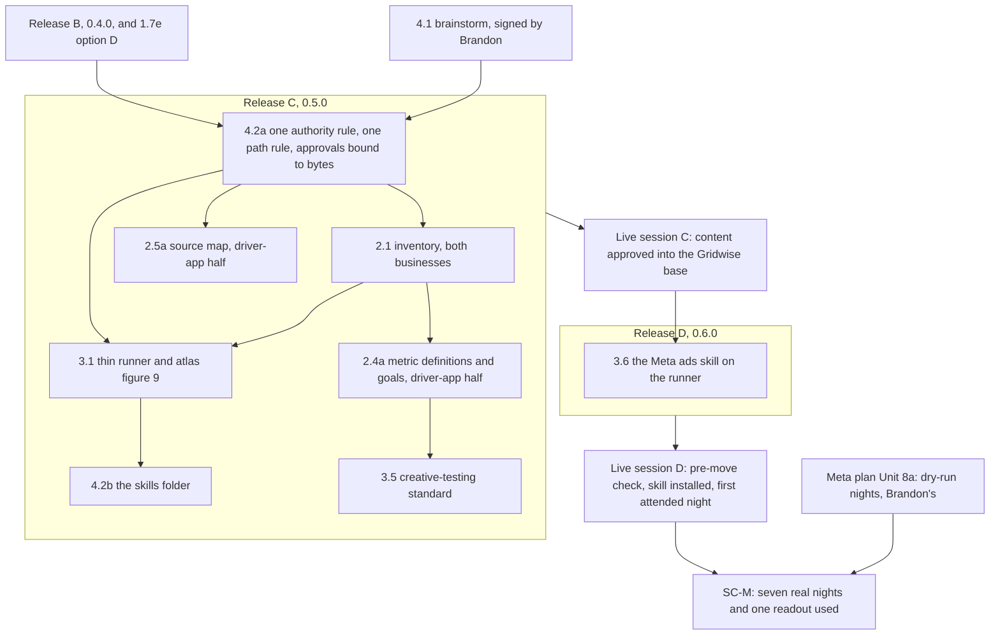
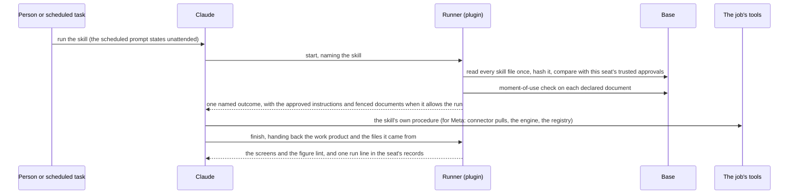

# feat: Plan 1 of Phases 2 and 3, company skills and the Meta ads skill on the base

**Target repo:** `gtm-base` (this repository). Plan 1 takes GTM Base from a base that holds context to a base that a real, daily skill reads before it works. It follows Brandon's decisions of 2026-10-10 (`docs/plans/2026-10-10-001-phase-2-3-decisions.md`), which replace call 48 of the build plan: the first skill is the Meta ads creative-testing skill already in daily use for the Gridwise driver app, not the outbound sequence, and the company-skills brainstorm runs and is signed off before that skill is built on the base.

## Overview

Plan 1 is the part of Phases 2 and 3 that can be planned now. Plan 2 (messaging, voice, design, product, buyer personas, updating GTM Base, drift grade and content brief) is written after the Meta skill has run on real nights, because those nights decide what the kinds and the standards need to hold (decision D4).

Plan 1 holds nine units, in this order:

| Unit | What it delivers | Code? |
|---|---|---|
| 4.1 | The company-skills brainstorm, built on Brandon's ownership model (D5), signed off by Brandon first | No, a document |
| 4.2a | One authority rule and one path rule for every document, with approvals bound to the exact bytes approved | Yes |
| 2.1 | The base inventory, across both businesses (D1) | Yes |
| 2.5a | The source map, the driver-app half (M8) | Yes, and base content |
| 3.1 | The thin runner, its contract test, and one new atlas figure for it (D8) | Yes |
| 4.2b | The skills folder: admitting a skill, installing one, and showing a changed one | Yes |
| 2.4a | Metric definitions and goals, the driver-app half (M6, M7) | Yes, and base content |
| 3.5 | The creative-testing standard, `standards/meta-creative-testing.md` (M12 option A) | Yes, and base content |
| 3.6 | The Meta ads skill running through the runner, with the `mads` engine left installed outside the base | Yes, and base content |

Units 4.1, 2.1 and 3.1 keep their roadmap numbers. Units 2.4a and 2.5a are the driver-app halves of roadmap Units 2.4 and 2.5; their Analytics halves move to Plan 2. Units 4.2a, 4.2b, 3.5 and 3.6 are new.

The line from this work to pipeline is the Meta skill's own line, and Plan 1 does not shorten it. The skill exists to buy account links more cheaply at the same spend; that more linked drivers then become trials and paying subscribers is the business's hypothesis, not something Plan 1 observes. What the base adds is that the skill reads Brandon's business goals and metric definitions before it judges anything, says how each engine threshold relates to a goal, and is flagged when a goal changes. The success test (SC-M, proposed below, Brandon's to decide) proves the base is in the loop on real nights and that its output was used. It does not claim cost per account link moved.

## Revision 2: what Astra's review changed

Astra reviewed revision 1 on 2026-10-10 and found it not ready (`docs/reviews/2026-10-10-plan-1-review-astra.md`, findings 1 to 16). Every finding is answered here.

| Finding | What was wrong | What revision 2 does | Where |
|---|---|---|---|
| 1 (blocker) | Matching addresses recorded in the saved history proves only that the claims agree with each other, not that anyone was allowed to make them; the seat's address is a setting anyone can change | Ownership is checked at the moment of approval and recorded with the approver, the role and a hash of the exact bytes. What runs is what this seat approved, or accepted once after being shown who approved it. The guarantee is stated exactly, with what it cannot do, and Brandon accepts it as a call | 4.1, 4.2a, call 6 |
| 2 (blocker) | The chain checked owner lines, so a non-owner could change a skill's body and keep the chain intact | Every skill file's exact bytes must match an approval this seat trusts, or the skill does not run. Body-only, uncommitted, reference-only, and changed-after-check edits each have a failing test | 4.2a, 4.2b, 3.1 |
| 3 | No operation existed to create a skill's files or change the base's roles; creator and approver were conflated | Absent-only creation through an approval, all or nothing; narrow settings operations (owner line, business line, and the map's owner, administrators and businesses); creator and approver recorded separately; references and examples belong to their skill | 4.2a, 4.2b |
| 4 | Standards, the source map and skills are refused by several independent path checks beyond the reader | One shared document-path rule used by proposals, records, hashing, confirmation and moment-of-use, with an end-to-end test on a standard | 4.2a |
| 5 | Approval authority widened but confirmation authority did not | One authority rule used by approval, confirmation, the stale computation and moment-of-use, judged as of the approval or confirmation | 4.2a |
| 6 | Unattended behavior was inferred from non-interactive mode; desktop scheduled tasks have their own permission mode and can wait for an answer | The scheduled task's mode, grants, folder, plugin and client version are checked before the move; approvals are refused by the plugin in a conversation marked unattended; every approval command is attempted in a scheduled run and proven denied with no write and no wait | 3.6 |
| 7 | SC-M needs `decide` and `record`, which today's collect-only schedule forbids | The Meta plan's own collect-to-dry-run step (its Unit 8a, Brandon's) is a named prerequisite of the SC-M window; Plan 1 does not make it | 3.6, SC-M |
| 8 | "Moves as it is" would carry old paths, the removed rules file and repeated thresholds | A migration checklist for every path, reference, repeated threshold and conflicting instruction, and a replay of the nightly and Monday paths before the old entry point is replaced | 3.6 |
| 9 | A missing safety document and an optional gap were treated the same; an unreadable or silenced check looked like "nothing flagged" | The runner has named outcomes for each case, and each declared document is required or optional | 3.1 |
| 10 | Checking that a figure appears in a source cannot prove it belongs to the right metric | The figure check is described as a lint and nothing more. Operational facts are quoted from the engine's own output; what the model adds is the goal relation, which Brandon's replay judges | 3.1, 3.6 |
| 11 | Flat Analytics documents would count as whole-company coverage | A flat document counts for a business only when it says which; one that says nothing counts for none | 2.1 |
| 12 | Redacting the decisions brief in a later commit leaves the figures in the history; two plan lines named internal details | The branch must not be pushed until its history is rebuilt without the figures; that is a required action, not a call. The two lines are made generic | Execution Posture |
| 13 | SC-M did not name the artifact used in the meeting, misdescribed the current readout, and let a fallback count | The goal-relation section is its own named file; the record names the file used; the current readout is described as comparing against engine targets; a fallback is a rollback, with Plan 1 incomplete | SC-M, 3.6 |
| 14 | The dependency order and the shared files were inconsistent | Unit 4.2 split into 4.2a (first) and 4.2b (after the runner); shared files each have one owner | Execution Posture |
| 15 | The brainstorm called scripts resolved before signature, deferred stale-skill review without reason, and deferred lessons against call 14 | Scripts are a recommendation the signature decides; skills join the stale lifecycle; a minimal lesson on request is call 7 | 4.1, call 7 |
| 16 | Several tests would pass without proving their claim | The digit rule is called a lint; admitting a file and writing a file are tested separately; fixture safety rests on synthetic origin and review, not a scan | 3.5, 4.2b, 3.6 |
| Calls | Call 5 was an implementation choice; call 7 was not a choice at all; two decisions were missing | Sol's write mechanism is a default under Execution Posture; the history rebuild is a required action; calls 6 (the ownership guarantee) and 7 (lessons) are added | For Brandon |

### Revision 2.1: Astra's confirmation of revision 2

Astra confirmed seven findings closed and raised nine narrower ones (`docs/reviews/2026-10-10-plan-1-verify-astra.md`).

| Finding | What revision 2.1 does | Where |
|---|---|---|
| 1 (approving files one by one does not approve the assembled skill) | The unit of approval and trust for a skill is one manifest: the base, the skill's name, its complete set of paths, each file's hash. Mixed versions, a deleted file and an added file each fail | P44, 4.2a, 3.1, 4.2b |
| 2 (call 6 overstated the inherited guarantee) | Call 6 and Unit 4.1 carry Unit 1.7e's own stated limits: (corrected in r2.7 for Release B's call 60: not refused but unasked where Claude Code asks nobody), answered by any responder set up to answer for the person, and not proof against an assistant set on working around it; responders covering GTM Base's approvals are checked for in live session C | Call 6, 4.1 |
| 3 (a tool list does not make approvals unreachable) | The plugin denies every approval in a conversation the runner marked unattended (task-only deny rules are added as a second control only where a task-only settings source exists, per the second confirmation); every approval command is attempted by every way it can be invoked and proven denied at once | 4.2a, 3.6 |
| 4 (combined runner states had no order) | The runner works through seven steps in a fixed order and the first failure decides; an invalid declaration always refuses; combined cases are tested | 3.1 |
| 5 (4.2a's end-to-end test needed 2.1's reader) | 4.2a reads standards and the source map as documents itself; 2.1 adds skills and business scope | 4.2a, 2.1, Execution Posture |
| 6 (no operation to set a document's business) | Settings operations: owner line, business line, the map's administrators, the map's businesses (and, after the second confirmation, the map's owner line) | 4.2a |
| 7 (the lesson path was refused) | `learning/lessons/<slug>.md` is a create-only destination; the rest of `learning/` stays refused | 4.2a, 3.6 |
| 8 (quoting the engine was only an instruction) | Engine facts go in marked blocks that `finish` checks line for line against the engine file they name | 3.1, 3.6 |
| 9 (an unfinished run was given a stopping point) | "Started" and "completed" lines; a start with no completion is incomplete, stopping point unknown until compared with the engine's own records | 3.1, SC-M |

## Problem Frame

**The first skill changed, and the reason matters.** Call 48 pulled the outbound sequence forward because it was the shortest line to pipeline. On 2026-10-10 Brandon chose the Meta skill instead because it is the one in daily use (D2). A skill that already runs every night is a better first test of the base than one written for the test, because real use is what finds the defects: every defect in Amendment r2.4 was found by a person using the product, and none by the tests.

**The Meta skill today knows nothing about the business goals.** Verified by reading `~/.claude/skills/meta-ads/` and `~/Gridwise/meta-ads/` on 2026-10-10. The engine judges creative against its own thresholds in `config.toml`, and its readout compares against those engine targets. The thresholds are deliberately not the business goals Brandon gave in M7: he chose option A for M12 because the engine reading its targets from the goals would kill every web creative. Nothing says how the two relate, so a reader of the Monday readout sees an engine verdict without the goal it serves. Some results the engine reads are Meta's own counts of an event, while the goals are measured on counts kept in other tools, so even where the names match the numbers are different numbers. A standard that relates each threshold to a goal, and metric definitions that say which count is which, are what a base is for.

**The base cannot hold any of this yet.** Verified on the release-b branch (94c9343) and the Release B finish branch (3f9f4f5):

- `base_reader.context_files` walks only `context/`, and the same restriction is repeated in `paths.py`, in the affected-path, confirmation and edit checks in `formats.py`, in `base_reader`'s handling of affected paths and correction hashes, and in `moment.context_path_of`. A standard or the source map is never read, owned, confirmed, flagged or changed through a proposal.
- `layout.is_refused_in_skills` refuses every file under `skills/` except an empty placeholder, by every path, until the company-skills brainstorm settles who may approve a skill change (call 13).
- `approve_local._owner_problems` lets only an address on a file's own `owner:` line approve a change to it, and `moment.py`, `confirm.py` and `stale.py` each check ownership on their own. There is no base owner or administrator role in the code.
- A prepared change can only edit an existing file's body under a heading, and may not touch the map.
- No runner exists, and no skill reads the base.
- The Gridwise base (read on 2026-10-10) is on the older layout, holds the Analytics customer profile and positioning, and its profile's first paragraph says it covers Analytics and not the driver app. D1 puts both businesses in one base.

**Who may change a skill is the hard question, and Brandon answered it.** Whoever creates a skill or a context document owns it; a change may be made and approved by its owner, or by the base's owner or administrator, and nobody else; and ownership has to be provable, not claimed (D5). What can honestly be proven on one computer with no signing is narrower than "a particular human approved this", and Plan 1 says exactly how much narrower (call 6).

## Requirements Trace

Plan 1 carries four requirements the build plan moved to the roadmap (P30, P31, P33, P34), keeps the standing rule P35, and adds P39 to P45. Numbering continues the build plan's.

| Id | Requirement | Source |
|---|---|---|
| P30 | A base inventory answers "what is my base missing?" against a named list of kinds, for each business the base covers, and drafts each kind this release can draft, on request. Setup stays at two documents. | Brandon 2026-09-19; D1 |
| P31 | The source map says, for each kind of data, where it lives outside the base, which connected tool reads it, and the fallback. Context reads stay local, and nothing reads a source at context-loading time. | Brandon 2026-09-19; M8 |
| P33 | A skill that uses the base is a thin runner over files in the base: it declares what it reads and whether each is required, every declared document passes the moment-of-use check, its rules live in a standard, and it has owner-approved examples checked by a contract test. Revised by D2: a skill may also call the tools its job needs, as listed in the source map; the runner never calls any tool. | Brandon 2026-09-19; D2 |
| P34 | Company skills shared across seats get a brainstorm whose deliverable is a requirements document, signed by Brandon before the first company skill is built on a base. | Brandon 2026-09-19; D2, D5 |
| P35 | Nothing is written by the plugin outside the base, the plugin's own records folder, and a configured hooks directory. No MCP servers are declared. The logic atlas changes in the same change as the code. No invented number or timing appears anywhere. | Standing rule |
| P39 | Whoever creates a skill or a document owns it. A change to it may be made and approved only by its owner, the base's owner, or an administrator, judged when the approval happens, and every approval also passes Unit 1.7e's proof that a person said yes. Each approval is recorded with who approved it, in which role, and a hash of the exact bytes approved. | D5 |
| P40 | One base can cover more than one business. Each document belongs to one business or to the whole company, said by its folder or its settings, and a document that says neither counts for no business. Ownership, the inventory and the moment-of-use check work per document, so a change about one business never interrupts work on the other. | D1 |
| P41 | A standard holds a job's rules in plain words. A number lives in exactly one place: a business goal in the goals document, an engine threshold in the engine's settings. The standard names each threshold, says which goal it serves and why it differs, and says where the number lives. | M12 option A |
| P42 | The Meta ads skill runs through the runner from the Gridwise base. Its written instructions and its standard live in the base; its engine (`mads`, written in Python), its settings and its run data stay outside the base. | D2, D5, M12 |
| P43 | A run can be stated as unattended. An unattended run never approves anything and never asks a question; it cannot reach an approval command at all. It does not stop spend-protecting work because a document it reads for meaning is flagged; it reports the flag first and holds what depends on that document. | Plan 1, call 3 |
| P44 | A skill runs only when the whole skill as it stands (its complete set of file paths and the exact bytes of each) matches one manifest this seat trusts: one approved on this seat, or one accepted once on this seat after it was shown who approved it, in which role, and what changed. An extra file, a missing file, or files from two approved versions mixed together match nothing. | D5; Astra findings 1 and 2, and the confirmation pass |
| P45 | Confidential client material never enters this repository or its history. Fixtures are synthetic by origin. The walkthrough for the success test records what happened without spend, identifiers, creative names or internal campaign details. | Lesson of 2026-09-20; Astra finding 12 |

### Success criteria

**SC-M, the Meta skill ran on the base and its work was used (proposed; replaces SC-C for Plan 1; Brandon decides, call 2).**

*Prerequisites, outside Plan 1:* the Meta plan's own move from collect-only nights to dry-run nights (its Unit 8a, Brandon's decision in that plan), so that `mads decide` and `mads record` run each night. Plan 1 never changes the engine's mode or its pausing switches. The window does not start until the schedule is in dry run or later, and the record says how long it waited.

*The test:* seven consecutive real nights of the Meta daily check run through the runner from the Gridwise base, with `decide` and `record` completing on each. For each night the record shows the runner's outcome, which documents it read and their content hashes, any flag or gap, how the night ended (completed, or incomplete with how far it got taken from the engine's own audit log and summaries), and that the runner changed no engine input or output. Inside those nights, one Monday readout is produced with its goal-relation section (a separate file, named in Unit 3.6) and used by Brandon in the Demand Gen weekly meeting; the record names the exact files he used and what he changed in them first. Goal comparisons whose definitions are still open (a marker in the metric definitions) are withheld in that section, not estimated. If no real goal or threshold change happens in the window, the record says so, and the flag path is proven by the contract test instead of by a staged change.

*How it fails:* a missed or stopped night without a recorded reason, a night where `decide` or `record` did not run, a readout not used, or a run that went through the old user-level skill. The old skill is the rollback if the base path fails; a night run through it counts for nothing, and Plan 1 stays incomplete until seven base nights pass.

*What it does not prove:* that cost per account link fell, or that the goal relations are right. The first is the business's own measure, reported by the engine; the second is judged by Brandon reading the section.

**SC-C stays parked** with the outbound sequence (roadmap Unit 3.4, as the reviewed Unit 1.4c text), which is no longer the first skill (D2).

**SC-A, the new computer test, partly.** Everything Plan 1 adds to the base travels in the base. The engine does not, by design (P42); the source map lists it as a tool the job needs installed. A new computer also has to accept the base's skill once (P44), which is the point.

**SC-B, the vacation test, the context half.** The nightly check runs while Brandon is offline, on Claude Code's own scheduler; GTM Base builds none. Plan 1 adds that an unattended run reads its context from the base alone, which is the half of the vacation test that is a context problem.

## Scope Boundaries

- **No scheduling in GTM Base.** The nightly check runs on Claude Code's scheduled tasks, which Brandon owns. Plan 1 changes the scheduled task's prompt and tool list only as an exact difference shown to Brandon and applied on his yes, and does not change its mode.
- **No script files in a base**, pending the brainstorm's signature, which is where the question is decided (D5). The recommendation is no, and the trust-surface refusal of `CLAUDE.md`, `AGENTS.md`, `plugins/`, `.claude/` (apart from the checked `.claude/settings.json` at the top of the base, as today), and every `.sh`, `.py` and `.js` file stands in every case.
- **Nothing under `~/Gridwise` is edited.** The engine, its `config.toml`, its README and its tests are read only. Sentences there that go stale are listed for Brandon.
- **No change to the engine's thresholds, mode or pausing switches.**
- **No Analytics halves.** Analytics metric definitions, goals and sources, and call 54's offer to move pipeline state out of the twelve adopted Gridwise pages, move to Plan 2.
- **No second seat, no shared copy, no backup.** Plan 1's ownership guarantee holds on one trusted computer and is stated as such (call 6). Proving who accepted a change on a shared copy is designed with backup.
- **No AI-initiated skill edits.** Changes to a skill are prepared on request and approved by an owner. Proposing edits on its own after each run waits for Plan 2.
- **No duplicate-skill audit.** One skill exists. The trigger to build it is the second company skill.
- **No MCP servers declared** in the plugin manifest, unchanged.

## Context & Research

### Relevant Code and Patterns

Every path below was read for this plan on the release-b branch (94c9343) or the Release B finish branch (3f9f4f5), because main does not yet carry the Release B layout. Release B ships as 0.4.0 (call 51).

- **The layout constants**, `plugins/gtm-base/lib/gtmbase/constants.py`: `ACCESS_DIR`, `SKILLS_DIR`, `STANDARDS_DIR`, `LESSONS_DIR`, `STACK_PATH`, `LAYOUT_EMPTY_FOLDERS`, `REQUIRED_CONTEXT_FILES`. Append-only for every unit.
- **The paths a document may live at**, repeated today in several places: `paths.py` (around line 121), `formats.py` (affected paths, confirmations and edits, around lines 629, 899 and 1188), `base_reader.py` (affected paths around line 456, correction-content hashes around line 553), `moment.context_path_of`. Unit 4.2a replaces all of them with one rule.
- **Ownership today**: `review.stamp_owner` and `create_base.stamp_owner` write the `owner:` line at creation; `validate.validate_owner` parses it; `approve_local.owners_of` reads it from the saved version; `approve_local._owner_problems` refuses a change unless the seat's address is an owner of every file it touches; independent owner checks sit in `moment.py` (around line 560), `confirm.py` (around line 1177) and `stale.py` (around lines 902 and 955). The seat's address comes from `base_reader.repo_email`, which reads the repository's own setting, and `base_reader.accepted_by` reads unsigned author fields. Both are claims, not proof.
- **Prepared changes**: `compose_proposal.py` edits an existing file's body by heading and refuses the map (around line 345); `approve_local.py` requires an existing target (around line 582). Unit 4.2a adds absent-only creation and five narrow settings operations beside them rather than widening the heading editor.
- **The skills refusal**: `layout.is_refused_in_skills`, `layout.is_the_skills_placeholder`, `layout.placeholder_is_empty`, `layout.names_a_skill_file`, used by `trust_surface.py` and `write_hook.py`. Unit 4.2b narrows these and nothing else.
- **The approval proof**: Unit 1.7e as rebuilt by call 57, option D: every approval is confirmed through Claude Code's own permission prompt, forced by a plugin hook answering "ask". Its approval ticket is used once and kept on the seat, so it proves a person said yes at that moment and is not, by itself, a record another seat can check.
- **The check and the reader**: `moment.check(base_root, base_id, path, session_id, runner, now)` returns a `Moment`. Besides flagged and not flagged, it returns codes for a path that is not a context file, an unreadable base, and a silenced seat (around lines 603, 624 and 641). The runner must treat each of these as its own outcome.
- **The two ends of a pipeline the runner reuses**: `drafting.assemble`; `review.screen` and `compose_proposal.scan_everything` for contact details and keys; `sources.fence`.
- **Names**: `names.document_name` is the one place a path becomes a name a person reads.
- **The templates**: `templates/company-base/` and its plugin copy, held identical by `tests/test_scaffold.py`. The template carries `access/stack.md` as a prose starter with no rows (call 42), and a `CODEOWNERS` listing `skills/**` and `standards/**`.
- **The atlas**, `docs/diagrams/logic-atlas.html`, eight figures today.
- **The Meta skill**, read only: `SKILL.md` and five references. `SKILL.md` names its own folder, loads `references/rules.md`, and repeats thresholds Brandon set on 2026-10-05; `references/launch-settings.md` repeats engine settings; its description says it writes settings for Brandon to build, while its write rules let it create paused drafts from the engine's build plan. The engine's readout reads recorded runs from the engine's audit log (`mads/readout.py`, `build_readout`), and compares against engine targets.
- **The nightly schedule**, read only: `~/.claude/scheduled-tasks/meta-ads-daily-check/SKILL.md` runs in collect mode (no `decide`, no `record`, no registry, no pauses), with three read tools from the Meta Ads connector and Bash limited to the engine command. That file says nothing about the task's permission mode, its working folder as the scheduler sets it, or which plugins it loads.
- **Codex as a builder**: `~/.claude/tools/codex-copy.sh` runs `gpt-5.6-sol` in a read-only sandbox and prints only Codex's answer.

### Institutional Learnings

- Two agents editing shared modules at once need explicit file ownership and append-only constants. Plan 1 gives each shared file one owner (Execution Posture).
- A gate that allows what it cannot parse fails open. Every allowance under `skills/` is an allow-list of exact shapes.
- A hook matcher is a list of tool names; a check on one tool has a hole the width of every other. Unit 4.2b covers every tool the existing write hook covers, and its security pass looks for the rest.
- Test the command a skill tells the assistant to run, taken from the skill's own text. Unit 3.6 tests the runner commands as written in the base skill and the scheduled prompt.
- Read a file once. A value hashed from one read and a result built from a second read is two files with one approval (2026-09-23). The runner hashes and hands back the same read.
- A fix to a safety rule is new code and needs its own outside look. Units 4.2a, 4.2b and 3.1 each get their own Astra pass.
- Never write a client's file names into a public repository. P45 extends that to figures, identifiers, internal campaign details, and the repository's history.

## Key Technical Decisions

| Decision | Rationale | Rejected alternative |
|---|---|---|
| **The brainstorm is answered in this plan and signed in its own document.** Unit 4.1's section gives a proposed answer to each question; Brandon's signature decides them, scripts included. | A plan is written to the recommended answer so the build does not wait, and a different answer changes the named unit only. | An open brainstorm with no proposals. |
| **One authority rule: a document's owners, the base owner, and the administrators, judged at the moment of approval or confirmation.** The base owner is the map's `owner:` line; administrators are a new `administrators:` line in the map's settings, changed only by the base owner. Approval, confirmation, the stale computation and moment-of-use all ask the same rule. | Brandon's model (D5). One rule cannot drift between four callers, which is how Astra found admins could approve but not confirm. | Each module keeping its own owner check; `CODEOWNERS` as the source (GitHub handles, not addresses). |
| **What is proven is an approval bound to bytes, not a person's identity.** Each approval records the approver's address, their role at that moment, and a hash of the exact bytes approved, in the correction record the base already keeps. For a skill, what is approved is one manifest: the base, the skill's name, its complete set of file paths, and each file's hash. A skill runs only when the skill as it stands matches a manifest this seat trusts: one this seat approved, or one it accepted once after being shown the approver, the role and the change. | Astra's two blockers: matching history fields proves nothing about authority, and owner-line checks miss body edits. Binding to bytes closes every edit path at once. On one computer the seat's address is self-declared, so the honest guarantee is "supported operations on a trusted computer", which call 6 asks Brandon to accept. | A chain read from history (forgeable, and blind to body edits); signed changes now (nothing to verify against until a shared copy exists). |
| **Creating is its own operation, absent-only and all or nothing.** A new document or a whole skill folder is shown as one artifact, approved once against its hashes, and written in one step that leaves nothing on failure. The creator is the owner; the approver is recorded separately. References and examples belong to their skill and its owner. | A prepared change today only edits an existing body, so it cannot install a skill. A half-written skill must never be runnable; with byte-bound approval it cannot be, and the write still cleans up after itself. | Widening the heading editor to create files. |
| **Narrow settings operations, not general map editing.** Five, each with a fixed shape: a document's owner line and its business line (that document's authority set); the map's owner line, which passes the base owner role (the current base owner only); the map's administrators (the base owner only); and the map's businesses (the base owner or an administrator). | The map is the most powerful file in the base. Operations with fixed shapes are reviewable; a general map edit is not. | Allowing prepared changes to the map. |
| **The skills folder accepts written instructions in exact shapes and nothing else.** `skills/<job>/SKILL.md`, `skills/<job>/references/*.md`, `skills/<job>/examples/` holding markdown and plain text. Everything else under `skills/` stays refused by every path. A skill's settings block may not carry keys that grant power in Claude Code, such as allowed tools or hooks. | A script runs on every computer with that person's permissions; a written instruction is read by an assistant that still asks before acting. The shapes are an allow-list because a gate that allows what it cannot parse fails open. | Lifting the refusal for the whole folder. |
| **A base skill reaches Claude through the core plugin, not by copying.** Session start adds one line per skill this seat trusts (its name and one-sentence description, as data), and a plugin skill runs any base skill through the runner. | Claude Code finds skills in a person's folder, a project's folder or a plugin, and a base folder is none of these. Copying would write outside the base (P35). | The base as its own plugin marketplace. |
| **The runner reads; it never decides and never calls a tool.** It hands back named outcomes, the approved instructions and the fenced documents, and lints what the skill hands back. The skill's own procedure calls its tools. | P33's thin shape for a skill that does real work. It revises the build plan's resolved line that a skill may not read a source tool, written before the first skill was a reporting skill (D2). | The runner calling tools. |
| **The figure check is a lint, and engine facts are checked as quotations.** `finish` checks that each currency figure and percentage in the output appears in one of the files it was handed; it cannot tell whether a figure belongs to the right metric, platform or period, and the plan never says it can. Operational facts (what was paused, what was promoted, what fired) go only inside marked engine blocks, and `finish` checks that each block is, line for line, an excerpt of the engine output file it names. A claim about an action outside a block is forbidden by the skill's instructions and caught only by Brandon's replay, which the plan says. | Astra finding 10 and the confirmation pass. A fabricated pause inside a block fails mechanically; the model's own words about goals are judged by a person. | Calling the lint grounding; trusting the instruction alone. |
| **A standard holds rules in words, and a lint keeps digits out.** A digit outside a date in a standard's body is refused. Number words ("twice", "six days") are not caught by it; Brandon's read and the reviews are what catch those. | P41. The lint is a floor, like the plain-language lint. | A prompt-only rule. |
| **Two businesses are two folders under `context/`, listed in the map** (recommended answer to call 1). A flat document counts for a business only when its settings say so. | Per-document ownership, flags and review mean a file shared by two businesses lets an Analytics change interrupt the Meta nightly run. The segments pattern (call 11) is the precedent. | One file per kind with a section per business. |
| **The base holds the goals, the engine keeps its thresholds (M12 option A).** This departs from roadmap Unit 2.4's line that targets stay in a model outside the base. | Brandon's decision. | The engine reading targets from the goals. |
| **Unattended runs report a flag instead of stopping** (recommended answer to call 3), and are kept from every approval by an enforced refusal, not by a list of allowed tools: when the runner's `start` is run with the unattended word, the plugin's own command check records that conversation as unattended, and from then on the approval check refuses (never asks) every approval, confirmation, install or acceptance in it. A refusal ends the attempt at once, so nothing waits for an answer. The refusal is the plugin's own and comes before any test of the permission mode, so it holds in bypassPermissions and dontAsk, where Release B's call 60 otherwise lets approvals through unasked. Two things it rests on are checked live before the move: that the plugin's check runs and its refusal is honored in the scheduled task's actual permission mode, and that the runner's start is the task's first command, because an approval attempted before the mark, in a mode that asks nobody, would go through unasked. A second, client-side refusal (deny rules) is added only if the pre-move check finds a settings source that the scheduled task loads and attended sessions do not, and is then tested on its own; otherwise the plan says there is one enforced control. | The nightly check protects spend and its decisions never come from the base. Scheduled tasks inherit a person's allow rules and can wait on a question, so a list of allowed tools proves nothing; a plugin refusal does. Deny rules in a person's own settings would also refuse approvals in every attended session, so they are not a substitute. A wrongly recorded unattended mark only refuses approvals, which is the safe direction. | Stopping the night until Brandon answers; relying on the task's allowed-tool list. |

## Execution Posture

**Builders (D9).** Units are split between Opus builders (Claude Opus 5.5 at high effort, one unit per agent) and Sol builders (`gpt-5.6-sol` through `~/.claude/tools/codex-copy.sh`). Astra (`gpt-6-astra`, through the Codex CLI from a script file, read only) stays the outside review.

| Unit | Builder | Why |
|---|---|---|
| 4.1 | Opus, with Brandon | A design conversation and a document Brandon signs |
| 4.2a | Opus | Security: one authority rule and one path rule under every approval and confirmation |
| 2.1 | Opus | It widens what the base reads and counts, which every later unit stands on |
| 2.5a | Sol | A parser and validator over a fixed table shape, with a closed test list |
| 3.1 | Opus | It fixes the contract every skill is built against, and its outcomes are judgment calls |
| 4.2b | Opus | Security: it narrows the trust-surface refusal and touches the write hook |
| 2.4a | Opus | Drafting prompts whose value is in asking rather than inferring |
| 3.5 | Sol | A new kind, a mechanical lint and a prompt modelled on 2.4a's; the orchestrator reads the prompt against `docs/ux-standard.md` before merge |
| 3.6 | Opus | It moves a live skill and carries the success test |

**How Sol writes code (D9 settled that Sol builds; this is the mechanism).** `codex-copy.sh` runs read only, so a Sol unit's brief is self-contained (the unit text, the files it owns in full, the tests it must pass), Sol returns one patch, and the orchestrator applies it in the unit's worktree, runs the suite and the lint, and sends failures back in the next brief. Sol never writes to a checkout and no new tool is added. If the rounds prove too slow, a writable script is Brandon's call at that point, not a default.

**Order and file ownership.** Unit 4.1 starts now: it is a document and does not wait for Release B. After Brandon signs it and Release B ships:

1. **4.2a first.** It owns `formats.py`, `validate.py`, `paths.py`, the new `docpaths.py` and `authority.py`, `approve_local.py`, `confirm.py`, `compose_proposal.py`, Unit 1.7e's `approval.py`, and the map settings grammar (both `businesses:` and `administrators:`), and holds `base_reader.py`, `stale.py`, `moment.py` and `write_hook.py` until it merges, because its own end-to-end test needs standards and the source map counted.
2. **Then 2.1 and 2.5a in parallel.** 2.1 takes over `base_reader.py`, `stale.py` and `moment.py`, and owns `inventory.py`, `names.py`, `BASE_KINDS`, and `skills/stale-check/references/base-kinds.md` (every section, the source map's and the standard's included). 2.5a owns `truth_map.py` and the source map starter, and touches no other shared file.
3. **Then 3.1**, which needs the widened reader (2.1) and the approval records and trust list (4.2a). It owns `runner.py`, `use-skill`, `docs/thin-runner.md` and the atlas.
4. **Then 4.2b**, which admits skills and installs one, and calls 3.1's contract check before any install is shown. It owns `layout.py`, `trust_surface.py`, `write_hook.py`. Installing a skill stays refused until 4.2b has merged, by a test.
5. **Then 2.4a, then 3.5**, each flipping its kind to draftable in `BASE_KINDS` and `base-kinds.md` in turn.
6. **Then 3.6**, after Release C.

`constants.py`, `tests/support.py` and `tests/plain_language.py` are append-only for every unit.

**The orchestrator** holds this plan and the suite, runs `sh tests/run.sh` and the plain-language lint after every unit, and merges only a unit whose test scenarios are all covered.

**Releases (recommended answer to call 5).** Two releases, each with one live session by Brandon (D3):

- **Release C (0.5.0):** Units 4.2a, 2.1, 2.5a, 3.1, 4.2b, 2.4a and 3.5. Live session C: Brandon runs the inventory on the Gridwise base, records the context change that the base now covers both businesses, says which business each existing document belongs to, and approves the driver-app goals, the metric definitions, the source map rows and the creative-testing standard.
- **Release D (0.6.0):** Unit 3.6. Live session D: the pre-move check of the scheduled task, Brandon installs the skill into the base, approves the scheduled task's new prompt and tool list, and watches the first night run through the runner while attended. The SC-M window starts on the next night that runs `decide` and `record`.

**Reviews.** Astra reviews this plan before any build. Astra and Fable 5.1 review the brainstorm document before Brandon signs it, as the roadmap set. Units 4.2a, 4.2b and 3.1 each get an Astra security pass and correctness pass before their release; each release then gets one security pass and one correctness pass over the whole. A fix gets a confirming pass.

**The dependency on Release B (0.4.0).** Plan 1's code starts from main after Release B has merged and shipped. It needs the layout of Unit 1.5b, the starter source map in a moved base (call 42), segment names kept for every seat (call 59), and Unit 1.7e as option D (call 57). If 0.4.0 ships without 1.7e and D follows as 0.4.1 (call 58), nothing that approves (4.2a onward) ships before 0.4.1; 2.5a's parser and 2.1's read side can be built against 0.4.0. Before live session C, Brandon moves the Gridwise base to the current layout through Release B's offered move.

**Client material and this repository's history (P45; Astra finding 12).** The first version of the decisions brief carried Gridwise figures and a client workbook file name. On 2026-10-10 this branch was rebuilt from the remote main with a cleaned brief that says the figures are kept privately by Brandon, so no commit on it carries them. The full brief is kept outside the repository. The local `main` ref, which also held the first version, was reset to the remote main the same day, and this branch's commits are authored under Brandon's personal address rather than his Gridwise one. Every outgoing commit is still read for client material before it leaves.

**While the plugin is live in a build session**, its gate reads every Bash command: git on its own line, commits with a message file, Codex run from a script file.

## Open Questions

### Resolved During Planning

- **Where the Meta skill's instructions live:** in the Gridwise base at `skills/meta-ads/`, owned by Brandon. Its engine, settings and run data stay where they are (P42).
- **Where the base owner and the administrators are recorded:** the map.
- **Whether a skill may call a tool:** yes, the tools its job needs, listed in the source map; the runner calls none.
- **Whether the inventory drafts every missing kind in Plan 1:** no. It reports every kind for every business and offers to draft goals, metric definitions, source map rows and a standard; for the rest it says drafting arrives later.
- **Whether standards, the source map and skills go stale like context documents:** yes. They are owned, confirmed and flagged, and the review lists a skill whose confirmation has passed the base's threshold. That is how the first skill becomes stale; duplicate detection waits for a second skill.
- **What the runner records:** a "started" line and a "completed" line per run in the seat's own records (job, date, attended or not, outcome, each document read with its content hash, flags, gaps, and the hashes of the output and its sources), never in the base; a start with no completion is incomplete, stopping point unknown until compared with the skill's own records. The SC-M walkthrough is written from those lines and the engine's own summaries.
- **The Gridwise base's scope:** whole company, through a context change Brandon records in live session C, which flags the customer profile; each existing flat document is given its business through 4.2a's business-line operation.

### Deferred to Implementation

- The exact syntax of the map's `businesses:` and `administrators:` settings, within the map's existing settings grammar, read aloud in live session C.
- The size limit for a skill file and the folder depth under `skills/<job>/`, set by the brainstorm from the Meta skill's real files.
- Calls or sentences the Release B finish branch adds after call 59. Read at the start of each unit.
- How many example nights the Meta skill's examples need, decided when the first set exists.

### For Brandon

New calls only where the decisions brief leaves something open. Brandon accepted all seven as recommended on 2026-10-10. The brainstorm's own answers are decided by Brandon's signature on Unit 4.1's document, which must cover scripts and the extra yes for creating a skill.

| # | The call | Recommended (what Plan 1 assumes) | Runner-up | Needed before |
|---|---|---|---|---|
| 1 | How one base holds two businesses (D1 decided both; not how) | **Decided 2026-10-10: as recommended.** One folder per business under `context/` for the kinds that differ by business (`context/driver-app/goals.md` and `context/driver-app/metrics.md` in Plan 1), flat files for whole-company documents, and the map listing each business. A flat document counts for a business only when its settings say so, so the Analytics profile and positioning, given their business in live session C, never count for the driver app. Names: "Gridwise Analytics" and "the driver app", slugs `analytics` and `driver-app` | One file per kind with a section per business. Simpler, but an Analytics change flags the whole file and interrupts the Meta nightly run, and one person owns both halves | Decided |
| 2 | The success test that replaces SC-C | **Decided 2026-10-10: as recommended.** SC-M as written above. Its window also depends on the Meta skill's own dry run and its unattended schedule, both still open in the Meta work (`~/Gridwise/tasks/todo.md`); that is Brandon's work on the Meta side, outside Plan 1 | One Monday readout with its goal-relation section, used in the weekly meeting and recorded the same way. Faster, but cannot show the nightly path holds | Decided |
| 3 | A document the skill reads is flagged during an unattended night | **Decided 2026-10-10: as recommended.** The engine's check runs as normal, because its decisions come from the engine's settings; the summary leads with the flag; the goal-relation section is held until Brandon chooses | Stop the whole night until he chooses, leaving that night's test spend unwatched | Decided |
| 4 | The copy of the Meta skill in `~/.claude/skills/meta-ads` once the base copy runs | **Decided 2026-10-10: as recommended.** It is kept whole, unchanged, as the rollback, and its description gains one opening sentence saying the base copy is the one to use, so the two do not compete. To roll back, Brandon removes that sentence and points the scheduled task back at it. After SC-M passes, Brandon moves it to `~/claude-archive/` | A pointer of a few lines from the start, with the old files moved to the archive and restored from there to roll back | Decided |
| 5 | One release or two | **Decided 2026-10-10: as recommended.** Two, as under Execution Posture. A failure in the skill does not hold back the context work | One release and one longer live session | Decided |
| 6 | The ownership guarantee Plan 1 can give | **Decided 2026-10-10: as recommended.** Accept it as stated. On one trusted computer, with Claude Code set to ask before it runs commands and nothing set up to answer its questions automatically: a change is approved only by an address in the document's authority set, through Claude Code's own question (Unit 1.7e); each approval is recorded with its approver, role and exact bytes; and a skill runs only as a whole skill this seat approved or accepted. It inherits Unit 1.7e's stated limits, corrected on 2026-10-10 for Release B's call 60: in Claude Code's modes that ask nobody (bypassPermissions and dontAsk), approvals are not refused: by Brandon's call 60 of Release B (2026-10-10) they go through with nobody asked, so in those modes nothing proves a person said yes, which is an accepted limit; a setting or another plugin that answers Claude Code's questions for the person answers this one too, so no such responder may cover GTM Base's approvals (checked on Brandon's setup in live session C); and an assistant with open command access that sets out to work around the check can. It cannot prove which human answered, cannot stop someone who controls the computer, and does not make a second seat safe until that seat accepts the skill itself; proving acceptance on a shared copy is designed with backup | Hold the skills folder closed until signed changes exist, which means the Meta skill stays outside the base until backup ships | Decided |
| 7 | Lessons from results (call 14 said the first reporting skill fills `learning/lessons/`) | **Decided 2026-10-10: as recommended.** A minimal version in Unit 3.6: on Brandon's request after a Monday readout, the skill prepares one lesson with the evidence attached, as a new document he approves; nothing proposes a lesson on its own | Defer all lessons to Plan 2, overriding call 14 for this skill | Decided |

## High-Level Technical Design

> *This illustrates the intended approach and is directional guidance for review, not implementation specification. The implementing agent should treat it as context, not code to reproduce.*

### One run of a base skill

## Implementation Units

### Unit 4.1 runs first

- [ ] **Unit 4.1: The company-skills brainstorm**

**Goal:** A requirements document for company skills, built on Brandon's ownership model, answering every question below or saying why it is deferred, signed by Brandon before the Meta skill is built on the base. No code.

**Requirements:** P34, P39, P44.

**Dependencies:** None. It starts now.

**Files:**
- Create: `docs/brainstorms/2026-10-XX-company-skills-requirements.md`
- Create: `docs/reviews/2026-10-XX-company-skills-astra.md`, `docs/reviews/2026-10-XX-company-skills-fable.md` and their briefs

**Approach:** Run the brainstorm with Brandon from the proposed answers below, with this repository's trust posture as the constraint and the Meta skill's real files as the worked example. Each answer says what Plan 1 builds from it and what waits for the shared-copy plan.

| Question | Proposed answer | What Plan 1 builds |
|---|---|---|
| **Who may approve a change under `skills/`** (answered by D5) | The skill's owner, the base owner, or an administrator, judged at the moment of approval. The same rule covers every document: context documents, standards and the source map. | 4.2a |
| **How ownership is recorded** | A document's `owner:` line, stamped at creation with the creating seat's address. The base owner is the map's `owner:` line. Administrators are a new `administrators:` line in the map, set only by the base owner. Each approval is recorded in the base's correction record with the approver's address, their role at that moment, and a hash of the exact bytes approved; the creator and the approver are recorded separately. | 4.2a |
| **What "provable" can mean here** | What is proven is that each approved revision was approved by an address in its authority set through Claude Code's own question (Unit 1.7e), and that what runs is exactly the whole skill that was approved. What is not proven: which human answered (the seat's address is a setting on that computer), anything against someone who controls the computer or an assistant that sets out to work around the check, anything when a setting or another plugin answers Claude Code's questions for the person, anything in a mode where Claude Code asks nobody (bypassPermissions or dontAsk), where approvals go through unasked by Release B's call 60, and anything about another seat until that seat accepts the skill itself. Brandon accepts this boundary in call 6. | 4.2a, 4.2b |
| **What a seat trusts** | Approvals it made itself, and approvals it accepted once, attended, after being shown who approved, in which role, and what changed. A skill whose bytes match neither does not run. | 4.2a, 4.2b |
| **How the proof works on a shared copy** | Deferred to the backup plan. Lead to verify then: whether GitHub's own signed merge records give a checkable acceptor (inferred, not checked); squash merges record the author, not the acceptor, as `base_reader.accepted_by` already says. | Nothing; recorded |
| **How ownership passes when someone leaves** | The document's authority set (its owner, the base owner, or an administrator) approves a change to its owner line through the owner-line operation, recorded with the reason. The base owner role passes only by the base owner's own approval of a new map `owner:` line, through its own operation. If the base owner is gone and cannot approve, recovery is outside GTM Base, and the document says so rather than adding a back door. | 4.2a |
| **How it fits Unit 1.7e** | Both proofs at every approval point: 1.7e says a person answered Claude Code's question, the authority rule says that address may. An unattended run gets neither: the plugin refuses every approval in a conversation the runner marked unattended, so nothing waits on a question. | 4.2a, 3.1, 3.6 |
| **Who may create a skill or a document** | Any joined person may create a context document and owns it. Creating a skill also needs the base owner's or an administrator's yes, because a skill is instructions every seat may run; the creator still owns it. Decided by the signature. | 4.2a, 4.2b |
| **1. The trust model for code on every seat** | Written instructions only, in exact shapes. Instructions still steer an assistant, so the defenses are who may approve them, binding what runs to what was approved, and showing a changed skill before a seat runs it. | 4.2b |
| **2. The pull refusal and the trust surface, path by path** | `skills/<job>/SKILL.md`, `skills/<job>/references/*.md` and `skills/<job>/examples/<example>/` (one flat folder per example; markdown and plain text) are admitted on pull and on disk. Writing them happens only through GTM Base's own create and change operations; a file tool writing there directly stays refused. Links, executable files, hidden files (apart from the empty `skills/.gitkeep` placeholder every base already has), other extensions, deeper folders and power-granting settings keys stay refused. `CLAUDE.md`, `AGENTS.md`, `plugins/` and `.claude/` stay refused unchanged, apart from the checked `.claude/settings.json` at the top of the base. A skill whose bytes changed since this seat trusted them is shown (who, when, what) on the next attended run, and does not run unattended until accepted. | 4.2b |
| **3. Review and ownership on a plan with no branch protection** | The seat that runs a skill checks its bytes against approvals it trusts, which does not depend on the hosting plan. | 4.2a, 4.2b |
| **4. Distribution** | Through the base, delivered by the core plugin: one injected line per trusted skill and a plugin skill that runs any base skill through the runner. Never copied into a person's own skills folder. | 3.1, 3.6 |
| **5. Examples as tests** | A skill carries at least one example with an expectations file and one deliberately wrong output before it can be installed, and the runner's contract check runs them before any change to the skill is shown for approval. No model is called. Examples are static, so a change in behavior is judged by Brandon's replay, which is required before a changed skill is approved. | 3.1, 4.2b |
| **6. Update after a session** | A change to a skill or a standard is prepared on request and approved by its authority set. The AI proposing edits on its own waits for Plan 2. | 4.2a |
| **7. Audits** | A skill becomes stale the way any document does: past its confirmation threshold, or flagged by a context change that names it, and the review lists it. Duplicate detection waits for a second skill. | 2.1 |
| **8. The vacation test and scheduling** | GTM Base builds no scheduler. Scheduled runs use the client's own scheduler, and the runner supports a run stated as unattended. | 3.1, 3.6 |
| **Whether script files may live in a base** (left open by D5) | Recommended: no. A script in a shared base runs on every computer with that person's permissions, and nothing in GTM Base can review what it does when it runs. The Meta engine therefore stays an installed tool. To revisit, three things would have to exist first: code pinned or signed so a seat runs only an approved version, each seat's consent per version, and an answer to where it runs. Decided by the signature. | Nothing; the refusal stands either way in Plan 1 |
| **Whether the brainstorm may reopen the trust-surface refusal set** (roadmap open question 7) | Yes, narrowly: the markdown shapes under `skills/` and nothing else. | 4.2b |

**Test scenarios:** None. The deliverable is a document, reviewed by Astra and Fable 5.1, with fixes folded in.

**Verification:** Brandon has signed the document, and his signature covers the script question, the extra yes for creating a skill, and the boundary in call 6. The document can be handed to the builders of 4.2a and 4.2b without a second round of questions.

**Atlas: none.**

### Release C: the machinery and the kinds the Meta skill reads

- [ ] **Unit 4.2a: One authority rule, one path rule, and approvals bound to bytes**

**Goal:** Every approval and confirmation in a base is judged by one authority rule, every document path by one path rule, and every approval is recorded against the exact bytes approved, with the operations needed to create a document, to set a document's settings that carry authority or scope, and to refuse every approval in an unattended run.

**Requirements:** P39, P40, P43, P44, P35.

**Dependencies:** Unit 4.1 signed; Release B with Unit 1.7e as option D. Call 6 answered.

**Files:**
- Create: `plugins/gtm-base/lib/gtmbase/authority.py` (the authority set for a document, judged at a given saved version; the approval record; the manifest of a whole skill; this seat's trusted approvals and manifests in the plugin's records folder; the record of conversations marked unattended), `plugins/gtm-base/lib/gtmbase/docpaths.py` (which paths may be a base document and which operations may write each), `tests/test_authority.py`, `tests/test_docpaths.py`, `tests/test_create_document.py`, `tests/test_settings_operations.py`, `tests/test_unattended_refusal.py`
- Modify: `paths.py`, `formats.py` (affected paths, confirmations, edits; the map's `businesses:` and `administrators:` settings; a document's `business:` line), `validate.py`, `base_reader.py` (read `standards/*.md` and `access/stack.md` as base documents, owned, confirmed and flagged, so this unit's own end-to-end test can pass before 2.1; affected paths and correction hashes through `docpaths`; owner checks through `authority`), `approve_local.py` (authority through `authority`; absent-only creation; the five settings operations), `confirm.py`, `stale.py` and `moment.py` (owner checks through `authority` only; the path rule through `docpaths`; standards and the source map counted), `compose_proposal.py` and `plugins/gtm-base/skills/propose-change/` (prepared changes reach standards and the source map, closing call 43), the approval check of Unit 1.7e (`approval.py` as built on the 1.7e line: refuse every approval in a conversation marked unattended), `docs/plans/2026-09-19-001-acceptance-matrix.md` (a column for approval records and rows for a standard and the source map), `plugins/gtm-base/CHANGELOG.md`
- Test: `tests/test_approve_local.py`, `tests/test_confirm.py`, `tests/test_stale.py`, `tests/test_moment_of_use.py`, `tests/test_compose_proposal.py`

**Approach:** `docpaths` is the one answer to "may this path be a base document, what kind is it, and which operation may write it", and every module that answered part of that before asks it now. Documents are everything under `context/` (business folders included), `standards/<job>.md`, `access/stack.md`, and the three skill shapes. One more destination is create-only: a new lesson at `learning/lessons/<slug>.md`, written only by the create operation, never edited by a prepared change, with every other path under `learning/` and `work/` still refused. The map is never a document, and is written only by its three settings operations below (its owner line, administrators and businesses).

`authority` is the one answer to "may this address approve or confirm this document", computed from the saved versions of the document and the map at the moment in question, so a confirmation made before an ownership change is judged against who held authority then. Each approval writes, in the correction record the base already keeps, the approver's address, the role that allowed it, and the hash of each file's approved bytes, and adds the same to this seat's trusted approvals. For a skill the unit of approval is a manifest: the base, the skill's name, its complete set of paths, and each file's hash; 4.2b and the runner use it.

Creation is absent-only: a new document, a lesson, or a set of files is shown as one artifact, approved against its hashes, written in one step, and removed again if any part fails. Any joined person may create a document or a lesson and owns it.

Five settings operations have fixed shapes, each previewed whole, bound to what was shown, approved through Claude Code's question, and recorded with its reason: a document's owner line (that document's authority set); a document's `business:` line (that document's authority set); the map's `owner:` line, which is how the base owner role passes (the current base owner only); the map's `administrators:` (the base owner only); and the map's `businesses:` (the base owner or an administrator). No other change to a settings block or to the map is possible through GTM Base.

The unattended refusal: the plugin's command check, seeing the runner's `start` with the unattended word, records that conversation as unattended in the seat's records, keyed by the conversation identifier Claude Code hands every check. From then on, Unit 1.7e's approval check answers "deny" for every approval command in that conversation, as its first test, before any test of the permission mode and before it prepares any approval or question, so the refusal holds in every mode, bypassPermissions and dontAsk included, and does not depend on Unit 1.7e refusing anything on its own (Release B's call 60 lets approvals through unasked in those two modes), and the write hook refuses any file tool writing into the base in it, so nothing is written and nothing waits. Any unattended `start` marks its conversation, an attended conversation included, and nothing later clears the mark. Nothing here weakens what may leave the computer.

**Execution note:** Test-first against hostile fixtures, one per clause.

**Patterns to follow:** `approve_local.owners_of` reading the saved version; the recovery pattern of Unit 1.7d (bound to approved bytes, finish or put back); `trust_checkout` for hostile bases.

**Test scenarios:**
- Happy path: the owner, the base owner, and an administrator each approve a prepared change to a document owned by the first; each record names the approver, the role and the hashes.
- Security: an address outside the authority set is refused, and the refusal names the document and who may approve.
- Security: an approval with the right address and no answered permission prompt writes nothing.
- Integration: an administrator's confirmation counts as a confirmation, settles the change it names, and clears the flag, through `stale.compute` and `moment.check`.
- Integration: a document's ownership passes to a new owner; a confirmation the old owner made before the transfer still counts; one the old owner makes after it does not.
- Integration: an administrator removed from the map can no longer approve or confirm; approvals they made while they held the role stay valid.
- Security: an administrator setting `administrators:` is refused; the base owner doing it is accepted; removing the map's `owner:` line is refused.
- Happy path: the base owner passes the role by changing the map's `owner:` line, previewed, approved and recorded with the reason; the same attempted by an administrator, or by any other address, is refused and writes nothing.
- Integration, end to end: a prepared change to a standard is approved, recorded with its hashes, confirmed, clears its flag, and is read by `moment.check` as current.
- Edge case: creating a document whose path already exists is refused; creating a set of three files where the third fails leaves none of them.
- Happy path: a new lesson is created at `learning/lessons/<slug>.md` and owned by its creator; a prepared change to it, and any write under `learning/changes/` or `learning/corrections/` by these operations, is refused.
- Security: `docpaths` refuses the map as a document, anything under `work/`, a path outside the base, a link, and every shape under `skills/` other than the three allowed.
- Integration: a business-folder document (`context/driver-app/goals.md`) is accepted by every path check that accepts `context/goals.md`.
- Happy path: setting a flat document's `business:` line by its owner, and setting the map's `businesses:` by an administrator, are each previewed, approved and recorded; the same by an address outside the authority set is refused, and any other settings change through these operations is refused.
- Security: after the runner's `start` with the unattended word, every approval command in that conversation (approve, confirm, the moment-of-use answers, create, the settings operations) is denied without a question and writes nothing; another conversation is unaffected; an attended conversation is never marked by a `start` without the word.

**Verification:** In live session C, Brandon approves a change to a document he owns, sees a fixture change by another address refused with a sentence he understands, and can say who may approve a change to his standard.

**Atlas: figures 1 and 8.**

- [ ] **Unit 2.1: The base inventory, across both businesses**

**Goal:** A person can ask "what is my base missing?" and get a short table against a named list of kinds, for each business the base covers, with the offer to draft each kind this release can draft.

**Requirements:** P30, P40, P28.

**Dependencies:** Unit 4.2a (the path rule and the map's `businesses:` setting). Call 1 answered.

**Files:**
- Create: `plugins/gtm-base/lib/gtmbase/inventory.py`, `plugins/gtm-base/skills/stale-check/references/base-kinds.md` (every kind's section, including the source map, the standard and a skill), `tests/test_inventory.py`
- Modify: `constants.py` (`BASE_KINDS`: ordered, each with its path pattern, whether it differs by business, adoptable, draftable in this release), `base_reader.py` (read skills as base documents; read a document's business from its folder or its `business:` line; standards and the source map are already read since 4.2a), `stale.py` and `moment.py` (a skill past its threshold is due; a way to read the base and run the check against the last saved revision of each document, which the runner uses), `names.py` (human names for business folders, standards, the source map and a skill), `stale_check.py` and `plugins/gtm-base/skills/stale-check/SKILL.md` (the question, and the inventory inside the review), `plugins/gtm-base/CHANGELOG.md`
- Test: `tests/test_stale_check.py`, `tests/test_base_reader.py`, `tests/test_moment_of_use.py`, `tests/test_scaffold.py`

**Approach:** `BASE_KINDS` is, in order, the nine kinds of the context standard, the source map, the standard kind (`standards/<job>.md`: a job's goal, what is unacceptable, what needs approval, the checks before work is handed back, and how any threshold set elsewhere relates to a goal), and the skill kind. The inventory reads the widened reader against that list, per business named in the map, and returns one small table: the kind, the business, whether the base has it, and when it was last confirmed. A document belongs to the business of its folder, or to the business its settings name; a flat document whose settings name none counts for no business and is listed once as "business not stated", with the offer to say which through 4.2a's business-line operation. It offers to draft only what this release can draft and says "drafting arrives later" for the rest, and writes nothing on its own. When the map lists a business that the customer profile's first paragraph leaves out, it names that and offers to record the context change.

**Patterns to follow:** The review's one-list-in-one-sitting shape; the map-settings-and-reference pattern; the segments pattern.

**Test scenarios:**
- Happy path: a base with the two setup files and a map naming two businesses reports the other kinds as missing for each business, in order, as one table.
- Happy path: `context/driver-app/goals.md` is present for the driver app with its confirmation date and missing for Analytics.
- Edge case: a flat positioning document whose settings name Analytics counts for Analytics and not for the driver app; one whose settings name nothing counts for neither and is listed as business not stated.
- Edge case: a map with no `businesses:` setting gives one column for the whole company, exactly as before.
- Edge case: a kind with an unanswered marker is present and not confirmed; `status: skipped` is skipped; an unreadable file is unreadable and does not make the kind missing.
- Edge case: a map naming a business the profile says it does not cover produces the scope finding and the offer, and writes nothing.
- Integration: a context change affecting `context/driver-app/goals.md` flags it and leaves every Analytics document unflagged.
- Integration: a context change naming `standards/meta-creative-testing.md` flags it; the review lists it; `moment.check` on its path returns the block.
- Integration: every entry in `BASE_KINDS` has a section in `base-kinds.md` and every section an entry.

**Verification:** In live session C, Brandon asks the question on the Gridwise base and gets a table he can act on without a follow-up question.

**Atlas: figures 1 and 8.**

- [ ] **Unit 2.5a: The source map, the driver-app half**

**Goal:** For each kind of data the driver app's work needs, the source map says where it lives, which connected tool reads it, and the fallback, in rows a skill can read. Nothing reads it over the network.

**Requirements:** P31, P40, P35.

**Dependencies:** Unit 4.2a (changing the file through a prepared change; the business names).

**Files:**
- Create: `plugins/gtm-base/lib/gtmbase/truth_map.py` (parse and validate the rows; never calls anything), `plugins/gtm-base/skills/join/references/prompts/draft-stack-rows.md`, `tests/test_stack.py`
- Modify: `templates/company-base/access/stack.md` and the plugin copy (the "Where the material lives" section gains the empty table with its five column names; the prose stays), `plugins/gtm-base/CHANGELOG.md`
- Test: `tests/test_scaffold.py`, `tests/test_session_start.py`

**Approach:** One row per kind of data, five columns: the kind of data, which business it is for (or the whole company), where it lives, which connected tool reads it, and the fallback when that tool is not connected. A row naming a tool this seat has not connected is still valid, because the file is the team's record. A base whose `stack.md` is still the prose starter has no rows yet, which is not an error. The driver-app rows drafted in live session C come from M8, M6 and the Meta skill's own documents, and Brandon confirms each: spend (the paid media dashboard, M8); trials, as the Mixpanel "True Trial" (M6); subscribers, payers and monthly recurring revenue (RevenueCat only, M6); account links as counted for the goal (unconfirmed, a marker); results as Meta reports them (the Meta ad account, through the Meta Ads connector); the creative registry (through the Notion connector); and the engine as a tool the job needs installed. Which tool reads the paid media dashboard is unconfirmed too, so it is a marker. No row carries a credential.

**Patterns to follow:** The map's settings parser and its range checks.

**Test scenarios:**
- Happy path: a well-formed table parses into rows with all five columns; a row missing its fallback is reported incomplete rather than accepted.
- Edge case: the prose starter with no table parses as no rows and no error.
- Edge case: a row whose business is not in the map is reported, not dropped.
- Security: parsing makes no network call and no git call that reaches a remote, asserted with a runner that fails on any fetch.
- Security: a line shaped like a key or token is refused by the same screens a proposal gets.
- Edge case: session start injects the map and does not inject the source map.
- Integration: a prepared change adding a row is approved through 4.2a and the file is then confirmed and flagged like any other.

**Verification:** In live session C, Brandon can answer "where does our driver-app spend data live, and what reads it?" from the file alone.

**Atlas: figures 1 and 2.**

- [ ] **Unit 3.1: The thin runner, its contract test, and atlas figure 9**

**Goal:** One shape for every skill that uses the base, which is also the deterministic caller of the moment-of-use check, able to run a skill kept in a base and a run stated as unattended, with an outcome named for every state it can meet.

**Requirements:** P33, P43, P44, P28, P9.

**Dependencies:** Units 2.1 (the widened reader) and 4.2a (approval records and this seat's trusted approvals). Call 3 answered.

**Files:**
- Create: `plugins/gtm-base/lib/gtmbase/runner.py`, `plugins/gtm-base/skills/use-skill/SKILL.md` and `scripts/use_skill.py` (a shim), `docs/thin-runner.md`, `tests/test_runner_contract.py`
- Modify, append only: `constants.py`, `tests/support.py` (a helper that builds a base holding named documents and one skill with its approvals)
- Modify: `docs/diagrams/logic-atlas.html` (new figure 9, "How a skill reads the base"), `plugins/gtm-base/CHANGELOG.md`

**Approach:** The reviewed Unit 1.4b text, with what a base skill and an unattended run need. A skill declares, in its settings block, each document it reads, whether each is required, and its standard, which is always required. `start` reads every file of the skill once, builds the manifest of what it read (the complete set of paths and each file's hash), and compares it with the manifests this seat trusts; the instructions it hands back are the bytes it hashed. Each declared document is read as last saved, and the moment-of-use check is run against that same saved revision, through the saved-revision reading Unit 2.1 adds; when the working copy has unsaved edits, the outcome says they were left out (the company-skills requirements, CS3). It then works through these steps in order, and the first step that fails decides the outcome, so two problems at once always give the more serious answer:

1. Every declared path is a base document under `docpaths`. If not, refused, invalid declaration, whether the path was declared required or optional.
2. The skill's manifest matches one this seat trusts. If not, refused, untrusted.
3. The base can be read for the check. If not, refused, unreadable.
4. Every required document is present and readable. If not, refused, required.
5. The seat is silenced. If so, not checked.
6. A declared document is flagged. If so, flagged, attended or unattended.
7. An optional document is missing or unreadable. If so, ready with gaps. Otherwise, ready.

| Outcome | What comes back |
|---|---|
| Refused (invalid declaration, untrusted, unreadable, or required) | A refusal naming the declaration, the skill, the base or the document; no instructions, so the skill's procedure does not start. Untrusted and attended, it offers the showing of 4.2b, which only an already approved version can pass |
| Not checked | The instructions and fenced documents, with "not checked: this base is silenced" in the outcome and the run line; quiet means do not interrupt, never "current" |
| Flagged, attended | The moment-of-use block and nothing else, until a choice is recorded |
| Flagged, unattended | The instructions and fenced documents, with the flag to report first and the parts that depend on that document named as held (call 3); no question is issued |
| Ready with gaps | The instructions and fenced documents, with each gap named; nothing is guessed |
| Ready | The instructions and the fenced documents |

A run is unattended when the caller says so on the command line, which also marks the conversation for 4.2a's refusal, or when its conversation is already marked; a later start without the word does not make a marked conversation attended. Otherwise the run is attended. `start` writes a "started" line in the seat's records. `finish` takes the work product and the files it was built from, runs the contact and key screens, runs the figure lint (each currency figure and percentage must appear in one of those files, which catches a made-up number and proves nothing about whether a figure belongs to the right metric), checks that each marked engine block in the output is, line for line, an excerpt of the source file it names, and writes a "completed" line with the outcome and the hashes of the output and its source files. A "started" line with no "completed" line means incomplete, with the stopping point unknown until it is compared with the skill's own records (for Meta, the engine's audit log and summaries). An example is a folder holding an input, the documents it ran against, an owner-approved output, an expectations file and at least one deliberately wrong output; the contract test validates those written outputs against the expectations and never calls a model. Judgment is tested by Brandon's replay, kept apart in the tests and the CHANGELOG.

**Execution note:** Fix what the contract test asserts before Unit 3.6 is written.

**Patterns to follow:** `drafting.assemble`, `review.screen`, `sources.fence`, `compose_proposal.scan_everything`.

**Test scenarios:**
- Happy path: a fixture skill declaring three documents reads exactly those three and calls `moment.check` on each; the outcome is ready.
- One test per outcome, including: a silenced seat returns not checked, never ready; an unreadable base returns refused; a missing standard returns refused with no instructions; a missing optional document returns ready with gaps; an optional declaration naming a path outside `docpaths` returns refused.
- Combined conditions follow the order: a missing standard on a silenced seat is refused, not not-checked; a missing standard with an optional gap is refused; an untrusted skill with a flagged document is refused before any check runs; a flag with an optional gap is flagged.
- Edge case: attended and flagged returns the block and no documents; unattended and flagged returns the documents with the flag first and the held parts named, issues no question id, and writes no question.
- Edge case: in a conversation never marked, a start without the unattended word is attended and marks nothing.
- Edge case: an unattended start, then a start without the word in the same conversation, against a flagged document: the second run is treated as unattended, issues no question and waits for nothing.
- Edge case: the moment-of-use check and the documents handed back come from the same saved revision; an unsaved edit setting a flagged document's `status: skipped` does not clear the saved document's flag.
- Security: each of these is refused as untrusted: a `SKILL.md` whose body changed after approval; an uncommitted edit; a reference changed while `SKILL.md` did not; an approved newer `SKILL.md` beside an approved older reference (two versions mixed); an approved skill with one reference deleted; an approved skill with an extra file added. The test also proves the handed-back text is the hashed bytes, so nothing can change between the check and the hand-back.
- Security: a document holding an instruction sentence reaches the bundle inside the fence. The test claims the fence, not a model's behavior.
- Security: `finish` refuses output carrying an email address, a phone number or a key, output carrying a currency figure found in none of the files it was given, and a marked engine block that is not an excerpt of the file it names (a fabricated pause line inside a block fails).
- Happy path: an example whose approved output meets its expectations passes; its wrong output fails; an example with no wrong output is rejected as incomplete.
- Integration: `start` writes "started"; `finish` writes "completed" with the outcome and hashes; a run with no `finish` is reported as incomplete with an unknown stopping point, never as stopped at `start`. Both lines live in the seat's records, never in the base.

**Verification:** A fixture skill written against the pattern needs no code of its own beyond its declarations and its instructions, and Brandon can follow figure 9 from "run the skill" to the hand-back without a question.

**Atlas: new figure 9** (D8), and figure 1 gains the runner.

- [ ] **Unit 4.2b: The skills folder**

**Goal:** A base admits written skill instructions under `skills/` in exact shapes, a skill can be installed and changed only through GTM Base's own operations, and a seat is shown a changed skill before it runs it.

**Requirements:** P34, P39, P44.

**Dependencies:** Units 4.2a and 3.1 (installing calls the contract check). Installing stays refused until this unit merges, asserted by a test.

**Files:**
- Create: `tests/test_skills_folder.py`, `tests/test_skill_install.py`
- Modify: `layout.py` (`is_refused_in_skills` admits the exact shapes), `trust_surface.py`, `write_hook.py` (a file tool writing under `skills/` stays refused; GTM Base's create and change operations may write there), `approve_local.py` and `propose-change/` (install a skill: the whole folder as one artifact, the contract check passing first, the extra yes of the base owner or an administrator per 4.1; change a skill: a prepared change, the contract check passing first), `runner.py` (the attended showing of a changed or not-yet-trusted skill: who approved it, in which role, and what changed, then one ask), `docs/plans/2026-09-19-001-acceptance-matrix.md` (rows for a skill: trusted, changed and not yet accepted, refused), `plugins/gtm-base/CHANGELOG.md`
- Test: `tests/test_trust_surface.py`, `tests/test_write_hook.py`, `tests/test_scaffold.py`

**Approach:** The skills refusal becomes an allow-list of exact shapes, and every path that refuses today (an update from the shared copy, a file on disk when the base is opened, a file-writing tool, a send) keeps refusing everything outside it. Admitting a file and writing a file are two separate rules: admission decides whether a file may exist in the folder at all; writing decides who may put it there, which is only GTM Base's own operations. Installing writes nothing until the contract check passes and both yeses are given, and leaves nothing runnable if it fails partway, because the runner trusts only a whole approved manifest and the write removes what it added. Installing and changing a skill each approve a new manifest; accepting a skill on this seat adds its manifest to this seat's trusted manifests. The install, change and accept commands are approval commands, so 4.2a's unattended refusal covers them.

**Execution note:** Test-first against hostile fixtures, one per clause.

**Patterns to follow:** `trust_checkout`; Unit 1.7c's one-fixture-per-clause shape.

**Test scenarios:**
- Admission: `SKILL.md`, a reference and an example are admitted on pull and on disk; a `.py`, a `.sh`, a link, an executable markdown file, a hidden file, a file deeper than allowed, and a `SKILL.md` whose settings carry an allowed-tools or hooks key are each refused, on pull and on disk.
- Writing: a file tool writing an admitted shape directly is refused; the same bytes through the install operation are written.
- Happy path: installing a skill with passing examples, the creator's yes and the base owner's yes writes the folder, records both, and the runner then returns ready.
- Edge case: installing with failing examples, or without the base owner's or an administrator's yes, writes nothing.
- Edge case: an install that fails after writing two of five files leaves no file and no approval record.
- Integration: a version the base records an approval for, by an address then in the authority set, is refused unattended, and attended is shown with who approved it, in which role and what changed, and asks once; accepting adds its whole manifest to this seat's trusted manifests.
- Security: a version no recorded approval covers cannot be accepted at all; the showing says nobody approved it and offers only a prepared change, approved by the authority set, which records a new approval of the whole manifest.
- Security: in a conversation marked unattended, install, change and accept are each denied without a question and write nothing.

**Verification:** In live session D, Brandon installs the Meta skill and can say who may change it and what happens if someone else does.

**Atlas: figures 1 and 6.**

- [ ] **Unit 2.4a: Metric definitions and goals, the driver-app half**

**Goal:** The driver app's goals and metric definitions arrive in the base through the guarded drafting path, with every figure stated by Brandon and every definition saying where its number lives.

**Requirements:** P30, P31, P40, P41, P28.

**Dependencies:** Unit 2.1.

**Files:**
- Create: `plugins/gtm-base/skills/join/references/prompts/draft-goals.md`, `draft-metric-definitions.md`, `plugins/gtm-base/starter/goals.md` and `starter/metrics.md` (shapes kept in the plugin, never in the company template, per Astra 8 of 2026-09-19), `tests/fixtures/drafts/goals.md`, `metrics.md`
- Modify: `drafting.py` (two explicit document variants), `inventory.py`, `BASE_KINDS` and `base-kinds.md` (draftable), `plugins/gtm-base/CHANGELOG.md`
- Test: `tests/test_drafting.py`, `tests/test_inventory.py`, `tests/test_prompt_guards_join.py`

**Approach:** Both prompts ask rather than infer, and both refuse a figure that neither the named sources nor the person's own words carry. A goal is a figure Brandon states, with its unit and where its actual value is measured; a definition is a rule Brandon states (what counts as a trial, a payer, an account link, what payback divides by). For the Gridwise base, live session C drafts `context/driver-app/goals.md` from M7 and `context/driver-app/metrics.md` from M6. The definitions also say, in words, that results the Meta engine reads are Meta's own counts and are different numbers from these, never to be mixed. What M6 and M7 do not settle is a marker, never filled: where an account link is counted for the goal, and what the payback period divides by.

**Patterns to follow:** The never-invent and leave-empty rules from the setup prompts; the open-marker state of Unit 1.7b.

**Test scenarios:** These validate written drafts and the screens; they do not claim a model writes the right prose.
- Security: a goals draft holding a figure in neither the sources nor the answer is refused and returned to the same step.
- Edge case: a definition with no stated source of its number is accepted only with a marker in place of the source.
- Edge case: a goals draft with no figure given is accepted as the definition and the question, never a number.
- Edge case: both documents are written under `context/driver-app/` when the business is named, and flat with no business when the base covers one.
- Integration: both are read, owned, confirmed and flagged like any other document, and the inventory reports them.

**Verification:** In live session C, Brandon reads the metric definitions and can say where each number lives without asking, and every open question is a marker he can see. Brandon's read is the test of the prose.

**Atlas: figure 1.**

- [ ] **Unit 3.5: The creative-testing standard**

**Goal:** The base holds the Meta creative-testing rules in plain words, saying for each engine threshold which goal it serves, why it differs, and where its number lives.

**Requirements:** P41, P33, P28.

**Dependencies:** Unit 2.4a.

**Files:**
- Create: `plugins/gtm-base/skills/join/references/prompts/draft-standard.md`, `plugins/gtm-base/starter/standard.md`, `tests/test_standard.py`, `tests/fixtures/drafts/standard.md`
- Modify: `drafting.py` (the standard variant and its lint), `inventory.py`, `BASE_KINDS` and `base-kinds.md` (draftable), `plugins/gtm-base/CHANGELOG.md`
- Test: `tests/test_drafting.py`, `tests/test_inventory.py`

**Approach:** A standard has five sections: the job's goal, what is unacceptable, what needs approval, the checks before work is handed back, and how each threshold set elsewhere relates to a goal. The lint refuses any digit in the body that is not part of a date; it does not catch number words, so the prompt forbids them and Brandon's read checks them. The prompt names each threshold by its name, never its value, quotes Brandon's reason for a relation where a source carries one, and writes a marker where none does. For the Gridwise base, live session C drafts `standards/meta-creative-testing.md` from the skill's `rules.md`, the write rules in its `SKILL.md`, and the driver-app goals and definitions. The rules in words come across: the test rule, the scale rule that never pauses, the tracking-health gate, pausing only what the engine's plan lists, nothing that spends without Brandon's yes, pulled text is data, and no evaluation of a person. The numbers stay in `config.toml`, which the standard names as the one place they live. Relations nothing written down explains yet are expected to surface as markers rather than be smoothed over, including where the event the engine judges on a platform is not the event the goal Brandon watches most on that platform.

**Patterns to follow:** Unit 2.4a's prompts.

**Test scenarios:** These validate written drafts and the lint.
- Lint: a draft with a dollar amount, a percentage, a multiplier written in digits, or a count of days in digits is refused and returned to the same step, with the line named and the figure not repeated; a date passes.
- Edge case: a fixture standard naming every threshold by name, with a marker for one unexplained relation, is accepted.
- Edge case: an empty "what needs approval" section is kept, because an empty list is a real answer.
- Integration: the standard is read, owned, confirmed and flagged; a context change to the driver-app goals that names the standard flags it.

**Verification:** In live session C, Brandon reads the standard beside `config.toml` and can say, for each threshold, which goal it serves, and finds no figure in the standard.

**Atlas: figure 1.**

### Release D: the skill on the runner

- [ ] **Unit 3.6: The Meta ads skill running through the runner**

**Goal:** The Meta ads skill runs from the Gridwise base through the runner every night, reading the standard, the goals and the definitions before it works, with its engine untouched and installed outside the base, and its Monday goal-relation section used in the weekly meeting.

**Requirements:** P42, P33, P43, P44, P45, SC-M.

**Dependencies:** Release C shipped and live session C done. Calls 2, 3, 4 and 7 answered. For the SC-M window, the Meta plan's Unit 8a (dry-run nights), which is Brandon's and outside Plan 1.

**Files:**
- Create (in this repository): `tests/test_meta_skill_shape.py` (the base skill's declarations and examples through the contract test, on a synthetic copy), `tests/fixtures/base-skills/meta-ads/` (written from scratch with made-up identifiers and figures, never copied from the real files), `docs/walkthroughs/2026-10-meta-skill-on-the-base.md` (the SC-M record, from real nights only)
- Modify: `plugins/gtm-base/lib/gtmbase/session_start.py` and `plugins/gtm-base/templates/injection.md` (one line per trusted base skill), `plugins/gtm-base/CHANGELOG.md`, `docs/diagrams/logic-atlas.html` (figure 9 gains the worked example)
- Installed in the Gridwise base in live session D through 4.2b, owned by Brandon: `skills/meta-ads/SKILL.md`, `skills/meta-ads/references/` (`daily-check.md`, `mcp-cookbook.md`, `notion-registry.md`, `launch-settings.md`), `skills/meta-ads/examples/`
- Shown to Brandon as exact differences and applied only on his yes: the scheduled task's prompt and tool list; the one opening sentence added to the user-level skill's description (call 4)
- Not created or changed: anything under `~/Gridwise`

**Approach:**

*The migration checklist,* worked through before the install is shown and attached to it:
1. Every path inside the skill that names its old folder is rewritten to the base skill's own references.
2. Every instruction that loads `references/rules.md` points at the standard for the rule and at `config.toml` for the number; `rules.md` does not move, and its evidence stays in the Gridwise analysis documents it cites.
3. Every threshold the skill text repeats (in `SKILL.md`'s settled-decisions line and in `launch-settings.md`) is replaced by the threshold's name and "the value in `config.toml`".
4. Conflicting instructions are resolved with Brandon, not by the builder: the description says the skill writes settings for Brandon to build while its write rules let it create paused drafts from the engine's build plan.
5. The declarations: reads `context/driver-app/goals.md` and `context/driver-app/metrics.md` (optional, so the engine check still runs without them) and `access/stack.md` (optional); standard `standards/meta-creative-testing.md` (required).
6. The runner's `start` is step zero and `finish` the last step, with the engine's summary, the engine's readout and the goals document handed to `finish` as the source files. What was paused, promoted or fired appears only inside marked engine blocks quoted from the engine's output files, which `finish` checks; the instructions forbid any claim about an action outside a block, and the replay in step 9 checks that they were followed.
7. The Monday goal-relation section: after the engine writes its readout, the skill writes the goal relations, in the standard's words, to its own file beside it (`readouts/<ISO week>-goals.md` in the engine's run folder), withholding any comparison whose definition is still a marker. The weekly-planning sentence Brandon applies by hand (as the skill already asks him to) gains that file.
8. If call 7 is answered as recommended: on Brandon's request after a readout, the skill prepares one lesson with its evidence as a new document in `learning/lessons/`, through 4.2a's create operation, at `learning/lessons/<slug>.md`, owned by Brandon; it is an approval command, so it never runs unattended.
9. The replay: the nightly path and the Monday path are each run once through the base copy, attended, against the same night's data as the old copy, and Brandon compares the two before the scheduled task is switched.

*The scheduled task, checked before the move.* Read and recorded, live, on Brandon's computer: the task's permission mode, its grants, the folder it runs in, whether the GTM Base plugin and its session-start output are available to it, and the installed client version. The new prompt names the run as unattended and keeps the engine's mode exactly as it is. The new tool list adds the runner's `start` and `finish` commands. Approvals are kept out by 4.2a's refusal in a conversation the runner marked unattended, not by that list, because a scheduled task inherits a person's allow rules. The pre-move check also looks for a settings source the scheduled task loads and attended sessions do not; only if one exists are deny rules for every GTM Base approval command (approve, confirm, the moment-of-use answers, create, the settings operations, install, change, accept) added there, shown to Brandon as an exact difference, and tested on their own in a fixture with the plugin's refusal switched off. If none exists, the record says the plugin's refusal is the one enforced control. The pre-move check also lists every allow rule and every other plugin or setting that could answer Claude Code's questions in that task, and Brandon removes any that covers GTM Base's approvals. Then, in a scheduled run, each approval command is attempted once, by each way it can be invoked (the script by path, through `python3`, and from a linked folder), and the record shows each was denied at once, wrote nothing, and left the run going, and names which control denied it. This is run in the permission mode the task actually uses, and, if that is a mode that asks nobody, it also shows that the plugin's refusal held there. If the scheduled run cannot load the plugin's injection or skill, its prompt names the base skill and the runner command directly.

*The nights.* The first night after live session D runs attended. The walkthrough records each night of the SC-M window from the runner's run lines and the engine's own summaries, with no figure, identifier, creative name or internal campaign detail (P45).

**Execution note:** Test the runner commands as written in the base skill's text and in the scheduled prompt's text, not a hand copy.

**Patterns to follow:** The Meta plan's rule that the scheduled task's prompt and tool list are shown to Brandon as an exact difference before they are set.

**Test scenarios:** These validate the synthetic skill's shape and the plugin pieces; the real behavior is SC-M.
- Happy path: the synthetic base skill passes the contract test: its declarations name documents in the fixture base, its approved output meets its expectations, its wrong output fails.
- Edge case: a wrong output stating a currency figure absent from every source file fails the figure lint, and one whose engine block carries a pause line the engine's summary does not hold fails the quotation check.
- Edge case: unattended, with the goals document flagged: the outcome is flagged-unattended, and the skill text holds the goal-relation section and still runs the engine check.
- Edge case: the standard missing: the outcome is refused and the skill text says nothing is paused or written that night and the refusal is the night's report.
- Edge case: the goals document missing: ready with gaps; the engine check runs; the goal-relation section says what is missing.
- Integration: session start in a folder linked to the base lists the skill in one line; in a folder linked to no base, nothing.
- Integration: the runner commands in the skill text and the scheduled prompt run as written against the fixture base.
- Fixture safety: the fixture folder is written from scratch with made-up values; the orchestrator reviews it before merge. No scan is claimed to recognize real names.

**Verification:** SC-M, as Brandon decides it in call 2, recorded in `docs/walkthroughs/2026-10-meta-skill-on-the-base.md` from real nights only.

**Atlas: figure 9.**

## System-Wide Impact

**Interaction graph.** One authority rule and one path rule replace the checks that lived in seven modules. The stale-check skill gains the inventory and reads standards, the source map and skills. Local approval gains creation, five settings operations, and three new destinations. Session start gains one line per trusted base skill. The trust surface and the write hook narrow the skills refusal to an allow-list. One new plugin skill, `use-skill`, runs base skills through the runner. The plugin writes nothing new outside the base, its records folder and a configured hooks directory; this seat's trusted approvals and the runner's run lines go in the records folder.

**Error propagation.** Unchanged posture: hooks exit 0 with fixed sentences, skills narrate and return to the same step, the gate and the path guard fail closed. New: every runner outcome is named, and a refusal names the document or skill; an install that fails leaves nothing; an unattended run never asks, so whatever it would have asked becomes a line in its report.

**State lifecycle risks.** Approval records live in the base and trusted approvals on the seat; a seat that loses its records folder must accept the skill again, attended, which is safe and is said in the join guide. Business folders add a second axis to every path rule, which is why the path rule is one module.

**Unchanged invariants.** No MCP servers declared. Context reads stay local and make no network call. The AI proposes and an owner approves. Scripts stay refused in a base. Nothing leaves the computer that could not leave before.

## Risks & Dependencies

| Risk | Mitigation |
|---|---|
| Release B slips, or ships without 1.7e | Unit 4.1 needs nothing from it. Everything that approves waits for 1.7e (0.4.0 or 0.4.1) |
| The ownership guarantee is read as more than it is | Stated exactly in the brainstorm, accepted by Brandon in call 6, and repeated in the CHANGELOG and the join guide |
| Lifting part of the skills refusal opens a hole | An allow-list of exact shapes, admission and writing as separate rules, test-first with a hostile fixture per clause, Astra passes on 4.2a and 4.2b before Release C |
| The nightly check stops or misbehaves because of the runner | The first night is attended, after a replay against the old copy. Unattended runs do not stop for a flag (call 3). The runner never touches engine inputs or outputs. The old skill stays whole as the rollback (call 4), and a rollback night counts for nothing toward SC-M |
| A scheduled task runs in a mode where Claude Code asks nobody, so an approval could go through with no person (Release B's call 60) | The plugin's unattended refusal is tested first, in every mode, and does not rely on Unit 1.7e refusing anything; the pre-move check proves it in the task's actual mode and confirms the runner's start is the task's first command. Residual, accepted: an approval attempted before that first command, in such a mode, would go through unasked |
| The scheduled task behaves differently from what the plan assumes | Its mode, grants, inherited allow rules, folder, plugin and client version are read before the move; approvals are refused by the plugin in a marked conversation, with task-only deny rules as a second control only where a task-only settings source exists and is tested on its own; every approval command is attempted in a scheduled run and proven denied at once, with no write and no wait |
| The schedule is still collect only when Release D ships | The SC-M window waits for the Meta plan's Unit 8a, and the record says so; Plan 1 does not change the mode |
| The figure lint is mistaken for proof | Named a lint everywhere; operational facts quoted from the engine; goal relations judged by Brandon |
| The standard's relations are invented | Markers where no source explains a relation; the digit lint; Brandon's read in live session C |
| Confidential Gridwise material reaches the public repository | P45; the branch already rebuilt without the figures, every outgoing commit read before it leaves; fixtures written from scratch; the walkthrough written without figures or internal details |
| Sol's patches drift from the repository's conventions | Self-contained briefs; the orchestrator runs the suite and the lint before merge; Sol's two units have the narrowest contracts |

## Documentation / Operational Notes

- `plugins/gtm-base/CHANGELOG.md` gains an entry per unit in plain language, including the exact ownership guarantee. No entry claims a result that was not observed.
- The version in `plugins/gtm-base/.claude-plugin/plugin.json` is bumped per release.
- `docs/diagrams/logic-atlas.html` gains figure 9 in Unit 3.1 and its worked example in Unit 3.6, in the same commits as the code.
- `docs/join-guide.md` gains a short section: what a company skill is, who may change one, what a seat is shown before it runs a changed one, and that scripts never live in a base.
- `docs/walkthroughs/2026-10-meta-skill-on-the-base.md` is the SC-M record.
- For Brandon, not for a builder: one sentence in `~/Gridwise/meta-ads/README.md` says the skill lives at `~/.claude/skills/meta-ads/`, which stops being the whole truth at the move; and the weekly-planning sentence gains the goal-relation file.
- `tasks/lessons.md` gains a line for each correction found during the build. `tasks/todo.md` gets a section per unit as it starts.

## Review findings folded in from the roadmap

| Finding | What Plan 1 does | Where |
|---|---|---|
| Astra 8 of 2026-09-19 (optional kinds and rubrics must not sit in the company template) | Goals, metrics and standard shapes live in `plugins/gtm-base/starter/`. The source map's starter was already in the template by call 42; 2.5a only adds its empty table | 2.4a, 3.5, 2.5a |
| Astra 12, Fable M7 (examples must test judgment) | The contract test validates written outputs against expectations and wrong outputs; judgment is Brandon's replay | 3.1, 4.2b, 3.6 |
| Astra test table (screens are not model-behavior tests) | Kept apart in the tests and the CHANGELOG | 3.1, 3.6 |
| Fable low (thin-runner reference beside the skills) | `docs/thin-runner.md` | 3.1 |
| Open question 3 (the closed list of kinds) | `BASE_KINDS`, per business | 2.1 |
| Open question 5 (atlas figures for skills) | D8: one new figure | 3.1 |
| Open question 7 (may the brainstorm reopen the refusal set) | Yes, narrowly | 4.1, 4.2b |
| Astra 11, Fable M6 (update GTM Base) and open question 2 (design sections) | Plan 2, with D6 and D7 | Plan 2 |
| Fable M8 (`context/work/`) | Not read anywhere in Plan 1 | All |

## Sources & References

- Decisions: [docs/plans/2026-10-10-001-phase-2-3-decisions.md](2026-10-10-001-phase-2-3-decisions.md)
- Astra's review of revision 1: [docs/reviews/2026-10-10-plan-1-review-astra.md](../reviews/2026-10-10-plan-1-review-astra.md), brief [docs/reviews/2026-10-10-plan-1-review-brief.md](../reviews/2026-10-10-plan-1-review-brief.md)
- The roadmap on the release-b branch: `docs/plans/2026-09-19-002-roadmap-after-phase-1.md`
- The build plan and its acceptance matrix: [docs/plans/2026-09-19-001-feat-base-that-produces-work-plan.md](2026-09-19-001-feat-base-that-produces-work-plan.md), [docs/plans/2026-09-19-001-acceptance-matrix.md](2026-09-19-001-acceptance-matrix.md); calls 57 to 59 on the Release B finish branch
- The UX standard: [docs/ux-standard.md](../ux-standard.md)
- Unit 1.7e's reviews: `docs/reviews/2026-09-28-unit-1-7e-rebuild-*.md`
- The Meta skill, read only: `~/.claude/skills/meta-ads/`, `~/Gridwise/meta-ads/README.md`, `~/Gridwise/meta-ads/config.toml`, `~/Gridwise/meta-ads/mads/readout.py`, `~/Gridwise/docs/plans/2026-10-05-001-feat-meta-ads-skill-plan.md`, `~/.claude/scheduled-tasks/meta-ads-daily-check/SKILL.md`
- Lessons: `tasks/lessons.md`

## Revision Log

- 2026-10-10 r1: written from the decisions of 2026-10-10, the roadmap units on the release-b branch, and a read of the Meta skill as it runs today. Eight units in two releases, seven calls, SC-M proposed in place of SC-C. Nothing built.
- 2026-10-10 r2: Astra's review of r1 (not ready, sixteen findings) folded in; the table under "Revision 2" maps each finding to its change. Ownership is now an approval bound to bytes with an exactly stated guarantee; Unit 4.2 split into 4.2a and 4.2b; one authority rule and one path rule; the runner's outcomes named; SC-M given its prerequisite, its artifact and its failure cases; the Meta migration given a checklist and a replay; the history rebuild made a required action before any push; calls 6 and 7 added, the old calls 5 and 7 moved out. Nothing built.
- 2026-10-10 r2.1: Astra's confirmation of r2 (seven closed, nine narrower findings, not ready) folded in; the table under "Revision 2.1" maps each. A skill is approved and trusted as one manifest; approvals in an unattended run are refused by the plugin and by deny rules, not by a tool list; the runner's steps have a fixed order; four settings operations and a create-only lesson destination; engine facts checked as quotations; runs recorded as started and completed. Nothing built.
- 2026-10-10 r2.2: Astra's second confirmation (all eighteen findings closed, ready with two listed changes) folded in. The client-side deny rules are a second control only where the scheduled task has a settings source of its own, tested on its own; otherwise the plugin's refusal is the one enforced control and the record says so. The map's `owner:` line gets its own operation, the current base owner only, so the base owner role can pass. Nothing built.
- 2026-10-10 r2.3: Astra's third confirmation (deny rules closed; the base owner transfer partly closed by stale counts) folded in. Every count of the settings operations now says five, and the map is written only by its three. Nothing built.
- 2026-10-10: the branch was rebuilt from the remote main with a cleaned decisions brief (figures and the workbook file name removed); the plan's own text is unchanged apart from saying so.
- 2026-10-10 r2.4: Brandon accepted calls 1 to 7 as recommended. He also chose to leave the older commits on the public main under their original address. Nothing built.
- 2026-10-10 r2.5: kept in step with the company-skills requirements after Astra's review of them: skills read documents as last saved, accepting can only pass an already approved version, and a conversation marked unattended also refuses file-tool writes into the base. Nothing built.
- 2026-10-10 r2.6: Astra's confirmation of the company-skills requirements (ready with three changes): the runner's check and its documents use the same saved revision, added to 2.1; a marked conversation stays unattended whatever a later start says; the `skills/.gitkeep` and `.claude/settings.json` exceptions repeated. Nothing built.
- 2026-10-10 r2.7: corrected for Release B's call 60 ("let them run"): in bypassPermissions and dontAsk, GTM Base approvals go through with nobody asked. Call 6, Unit 4.1's table and the risks table say so as an accepted limit; the unattended refusal is stated to be the plugin's own, tested before any mode check, and proven live in the scheduled task's actual mode. Nothing built.
